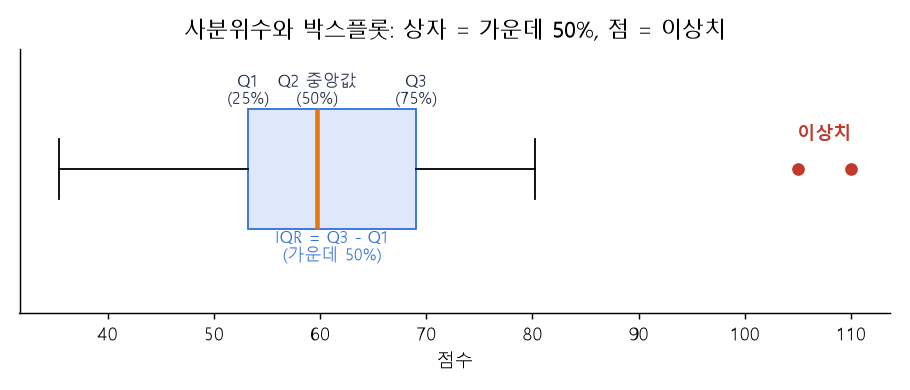

# 01 | 데이터 분석 기초 용어

@goals
- 데이터셋·피처·타깃·관측치·변수가 표의 어디를 가리키는지 말할 수 있다.
- 범주형과 수치형 데이터를 구분한다.
- 결측치·이상치·중복 데이터가 왜 문제인지 안다.
@end

## 01.0 | 들어가며: 엑셀 표 하나로 시작하기

데이터 분석의 첫 용어들은 모두 **표(테이블)의 어느 부분**을 부르는 이름이에요. 아래 "카페 손님" 표를 기준으로 하나씩 짚어 볼게요. 파이썬에서는 이런 표를 **pandas 의 DataFrame** 으로 다뤄요.

```python
import pandas as pd

# 카페 손님 데이터: 한 줄 = 손님 한 명
df = pd.DataFrame({
    "나이":   [23, 35, 41, 29, 35],
    "성별":   ["여", "남", "여", "여", "남"],
    "방문횟수": [12, 3, 8, 15, 3],
    "재방문":  ["예", "아니오", "예", "예", "아니오"],
})
print(df)
```

## 01.1 | 데이터셋 · Dataset
@term Dataset | 분석할 데이터 전체

분석하려고 모아 둔 **데이터 묶음 전체**예요. 위의 카페 손님 표 전체가 하나의 데이터셋이에요. CSV 파일 하나, 엑셀 시트 하나, DB 테이블 하나가 보통 데이터셋 하나가 됩니다.

> 💡 비유: 데이터셋은 **반 전체의 학생 명부**예요. 명부 한 권이 데이터셋입니다.

## 01.2 | 피처 · Feature
@term Feature | 분석·예측에 사용하는 입력 변수

예측할 때 **힌트로 쓰는 열(칼럼)**이에요. "재방문할까?"를 맞히려고 나이, 성별, 방문횟수를 본다면 이 세 열이 피처예요. **독립변수, 설명변수, 입력 변수(X)** 라고도 불러요.

> 💡 비유: 날씨를 예측할 때 쓰는 **구름 양, 습도, 바람** 같은 단서가 피처예요.

## 01.3 | 타깃 · Target
@term Target | 예측하려는 정답 변수

모델이 **맞혀야 하는 정답 열**이에요. 위 표에서는 "재방문" 이 타깃이에요. **종속변수, 레이블(label), y** 라고도 불러요.

```python
X = df[["나이", "성별", "방문횟수"]]   # 피처 (문제)
y = df["재방문"]                      # 타깃 (정답)
print(X.shape, y.shape)               # (행 수, 열 수)
```

> 💡 피처 = **시험 문제**, 타깃 = **정답지**. 머신러닝은 문제와 정답을 보며 규칙을 배워요.

## 01.4 | 관측치 · Observation
@term Observation | 데이터 한 행에 해당하는 관측 대상

표의 **한 행(줄)** 이에요. 손님 한 명, 주문 한 건, 하루치 날씨처럼 "관측한 대상 하나"를 뜻해요. **행(row), 레코드, 샘플, 인스턴스** 라고도 불러요. 위 표는 관측치가 5개예요.

## 01.5 | 변수 · Variable
@term Variable | 데이터의 속성 또는 특성

표의 **한 열(칼럼)** 이에요. 나이, 성별처럼 관측치마다 **값이 달라질 수 있는 항목**이라서 "변하는 수", 변수라고 불러요. 피처와 타깃도 모두 변수예요. (피처 = 입력으로 쓰는 변수, 타깃 = 정답으로 쓰는 변수)

```python
print(df.columns.tolist())   # 변수(열) 이름
print(len(df))               # 관측치(행) 개수
```

## 01.6 | 범주형 데이터 · Categorical Data
@term Categorical Data | 성별, 지역, 상품 종류처럼 종류를 나타내는 데이터

**종류나 그룹**을 나타내는 데이터예요. 더하거나 평균을 내는 것이 의미 없어요. ("여" + "남" = ?)

- **명목형**: 순서가 없음 — 성별, 지역, 혈액형
- **순서형**: 순서가 있음 — 학년(1·2·3), 만족도(낮음·보통·높음)

> 💡 숫자로 적혀 있어도 범주형일 수 있어요. **우편번호, 학번, 1=남/2=여** 는 숫자지만 크기 비교가 의미 없으니 범주형이에요.

## 01.7 | 수치형 데이터 · Numerical Data
@term Numerical Data | 나이, 매출, 가격처럼 크기를 비교·계산할 수 있는 숫자 데이터

**크기를 비교하고 계산할 수 있는** 숫자 데이터예요. 평균, 합계를 낼 수 있어요.

- **이산형**: 셀 수 있는 값 — 방문횟수, 자녀 수 (정수)
- **연속형**: 어떤 값이든 가능 — 키, 몸무게, 온도

```python
print(df.dtypes)                           # 열마다 자료형 확인
print(df.select_dtypes("number").columns.tolist())   # 수치형 열만
```

> 💡 pandas 버전에 따라 글자 열의 자료형이 `object` 또는 `str` 로 보여요. 둘 다 "문자(범주형 후보)"라는 뜻이에요.

## 01.8 | 결측치 · Missing Value
@term Missing Value | 값이 비어 있는(누락된) 데이터

**값이 비어 있는 칸**이에요. 설문에서 나이를 안 적었거나, 센서가 잠깐 꺼졌을 때 생겨요. pandas 에서는 `NaN`(Not a Number) 또는 `None` 으로 보여요.

```python
import numpy as np
d = pd.DataFrame({"나이": [23, np.nan, 41], "점수": [80, 75, np.nan]})
print(d.isnull().sum())          # 열마다 결측치 개수
print(d.fillna(d.mean()))        # 평균으로 채우기
print(d.dropna())                # 결측치가 있는 행 지우기
```

> 💡 결측치를 그대로 두면 평균이 틀어지거나 모델이 오류를 내요. **지우기(dropna)** 또는 **채우기(fillna: 평균·중앙값·최빈값)** 중 상황에 맞게 골라요.

## 01.9 | 이상치 · Outlier
@term Outlier | 다른 값들과 크게 차이 나는 데이터

다른 값들과 **동떨어지게 크거나 작은 값**이에요. 반 평균 키가 160cm 인데 250cm 가 있다면 이상치예요. 입력 실수일 수도 있고, 진짜 특별한 경우일 수도 있어요.



```python
s = pd.Series([62, 58, 65, 60, 59, 61, 150])
q1, q3 = s.quantile(0.25), s.quantile(0.75)
iqr = q3 - q1
print(s[(s < q1 - 1.5 * iqr) | (s > q3 + 1.5 * iqr)])   # IQR 규칙으로 찾은 이상치
```

> 💡 이상치는 무조건 지우지 말고 **왜 생겼는지** 먼저 봐요. 카드 사기 탐지에서는 이상치가 바로 찾고 싶은 대상이에요.

## 01.10 | 중복 데이터 · Duplicate Data
@term Duplicate Data | 같은 정보가 반복해서 들어간 데이터

**똑같은 행이 두 번 이상** 들어간 거예요. 주문이 실수로 두 번 저장되면 매출이 부풀려져요.

```python
orders = pd.DataFrame({"주문번호": [1, 2, 2, 3], "금액": [5000, 7000, 7000, 3000]})
print(orders.duplicated().sum())           # 중복 행 개수
print(orders.drop_duplicates())            # 중복 제거
```

@quiz
? "재방문 여부를 예측한다"에서 재방문 열은?
- 피처
+ 타깃
- 관측치
- 결측치
= 맞혀야 하는 정답 열은 타깃(종속변수, y)이에요.
? 표의 한 행(줄)을 부르는 이름이 아닌 것은?
- 관측치
- 레코드
- 샘플
+ 피처
= 피처는 열(변수)이에요. 행은 관측치·레코드·샘플이라고 불러요.
? 다음 중 범주형 데이터는?
- 키
- 매출액
+ 우편번호
- 온도
= 숫자로 적혀 있어도 크기 비교가 의미 없는 우편번호는 범주형이에요.
? 값이 비어 있는 칸을 무엇이라 하나요?
+ 결측치
- 이상치
- 중복 데이터
- 타깃
= 결측치(Missing Value)는 pandas 에서 NaN 으로 보여요.
? 반 평균 키 160cm 인 데이터에 250cm 가 있다면?
- 결측치
+ 이상치
- 범주형
- 중복
= 다른 값과 크게 동떨어진 값은 이상치예요.
@end
