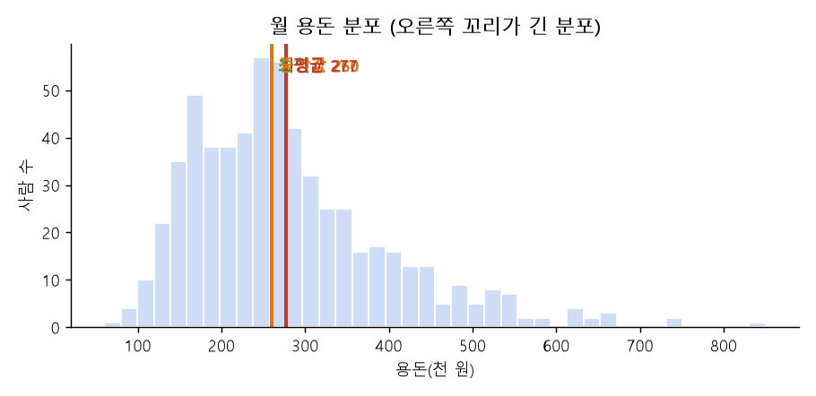
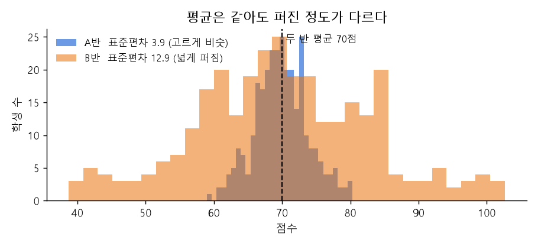
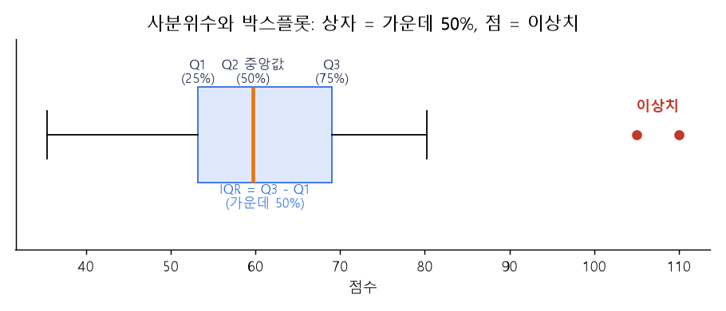
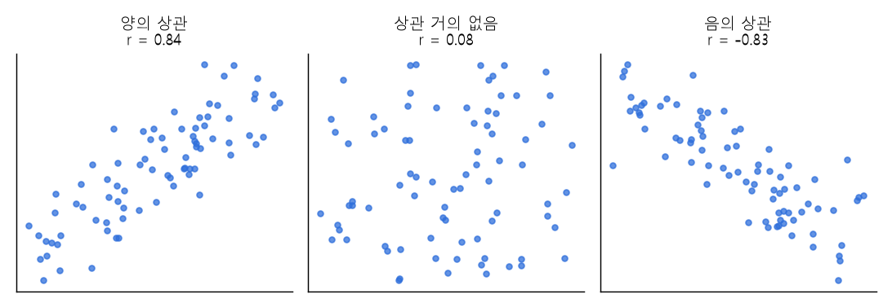
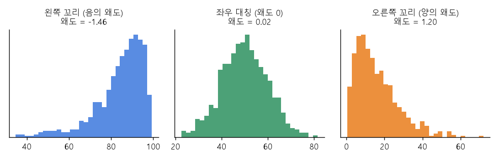
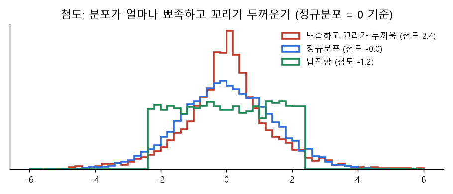
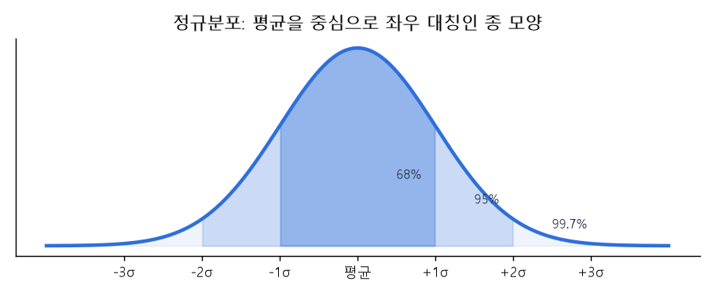

# 02 | 기초 통계 용어

@goals
- 평균·중앙값·최빈값을 구하고, 언제 무엇을 쓰는지 안다.
- 분산·표준편차로 데이터가 퍼진 정도를 읽는다.
- 사분위수·백분위수·상관계수·왜도·첨도의 뜻을 그림으로 이해한다.
@end

## 02.0 | 들어가며: 숫자 여러 개를 숫자 하나로

데이터가 100개, 1만 개면 하나하나 볼 수 없어요. 그래서 **"대표값"**(가운데가 어디?)과 **"퍼진 정도"**(얼마나 흩어졌나?)를 숫자 하나로 요약해요. 이 장의 예제는 아래 시험 점수를 같이 써요.

```python
import pandas as pd
scores = pd.Series([55, 60, 65, 70, 70, 75, 80, 85, 95, 100])
print(scores.describe())        # 개수, 평균, 표준편차, 최솟값, 사분위수, 최댓값을 한 번에
```

## 02.1 | 평균 · Mean
@term Mean | 데이터 합계를 개수로 나눈 값

모두 더해서 **개수로 나눈 값**이에요. 가장 많이 쓰는 대표값이지만, **이상치에 크게 흔들려요.**

```python
print(scores.mean())                    # (55 + 60 + ... + 100) / 10
print(pd.Series([3, 3, 4, 4, 100]).mean())   # 100 하나 때문에 평균이 22.8 로 튐
```

> 💡 비유: 친구 4명 용돈이 3만 원인데 1명이 100만 원이면 "평균 용돈 22만 원" 이 돼요. 이럴 땐 평균이 대표값으로 어울리지 않아요.

## 02.2 | 중앙값 · Median
@term Median | 크기순으로 정렬했을 때 가운데 값

값을 **크기순으로 줄 세웠을 때 한가운데** 값이에요. 개수가 짝수면 가운데 두 값의 평균이에요. **이상치에 잘 흔들리지 않아서** 소득·집값처럼 한쪽으로 치우친 데이터에 써요.



```python
print(scores.median())                       # 정렬 후 5·6번째 (70, 75)의 평균
print(pd.Series([3, 3, 4, 4, 100]).median()) # 4 — 100 이 있어도 그대로
```

## 02.3 | 최빈값 · Mode
@term Mode | 가장 자주 나타나는 값

**가장 많이 나온 값**이에요. 숫자뿐 아니라 범주형(가장 많이 팔린 메뉴)에도 쓸 수 있어요. 가장 많은 값이 여러 개면 최빈값도 여러 개예요.

```python
print(scores.mode().tolist())                              # [70]
print(pd.Series(["라떼", "아메리카노", "라떼"]).mode()[0])    # 라떼
```

## 02.4 | 분산 · Variance
@term Variance | 데이터가 평균에서 얼마나 퍼져 있는지 나타내는 값

각 값이 **평균에서 떨어진 거리를 제곱해서 평균**낸 값이에요. 클수록 데이터가 넓게 퍼져 있어요. 제곱을 해서 단위도 제곱(점², 원²)이 돼서 직접 읽기는 어려워요.



```python
import numpy as np
x = np.array([60, 70, 80])
print(((x - x.mean()) ** 2).mean())   # 직접 계산: (100 + 0 + 100) / 3
print(x.var(), pd.Series(x).var())    # numpy 는 n 으로, pandas 는 n-1 로 나눔(표본분산)
```

> 💡 numpy 와 pandas 의 분산 값이 다른 이유: pandas 는 **표본분산**(n-1 로 나눔)이 기본이에요. 표본으로 모집단을 추정할 때 더 정확하거든요.

## 02.5 | 표준편차 · Standard Deviation
@term Standard Deviation | 분산의 제곱근 (평균에서 보통 얼마나 떨어져 있나)

분산에 **루트(제곱근)** 를 씌운 값이에요. 단위가 원래대로 돌아와서 "평균에서 **보통 이 정도** 떨어져 있다"로 읽을 수 있어요.

```python
print(round(scores.std(), 2))   # 점수가 평균에서 보통 약 15점 정도 떨어져 있다
```

> 💡 평균 70점, 표준편차 5점 반은 다들 비슷하고, 표준편차 20점 반은 실력 차이가 커요.

## 02.6 | 최솟값 · 최댓값 · Minimum · Maximum
@term Min / Max | 가장 작은 값 / 가장 큰 값

**가장 작은 값과 가장 큰 값**이에요. 둘의 차이를 **범위(range)** 라고 해요. 데이터를 처음 받으면 최솟값·최댓값부터 보면 **입력 실수**(나이 -5, 키 999)를 빨리 찾을 수 있어요.

```python
print(scores.min(), scores.max(), scores.max() - scores.min())
```

## 02.7 | 사분위수 · Quartile
@term Quartile | 데이터를 4등분하는 경계값 (Q1·Q2·Q3)

정렬한 데이터를 **4등분하는 세 지점**이에요. **Q1**(25%), **Q2**(50% = 중앙값), **Q3**(75%). Q3 - Q1 을 **IQR**(사분위 범위)이라 하고, 가운데 50% 가 퍼진 폭이에요. 박스플롯이 바로 사분위수 그림이에요.



```python
print(scores.quantile([0.25, 0.5, 0.75]))
```

## 02.8 | 백분위수 · Percentile
@term Percentile | 데이터를 100 등분했을 때의 위치값

**아래에서 몇 % 지점**에 있는 값이에요. "상위 10%" 는 90 백분위수 이상이에요. 사분위수는 25·50·75 백분위수와 같아요.

```python
print(scores.quantile(0.9))     # 90 백분위수: 이 점수 이상이면 상위 10%
```

> 💡 수능 백분위 95 = 나보다 점수가 낮은 사람이 95% 라는 뜻이에요.

## 02.9 | 상관계수 · Correlation Coefficient
@term Correlation Coefficient | 두 변수가 함께 움직이는 정도 (-1 ~ 1)

두 변수가 **같이 커지는지(+), 반대로 움직이는지(-)** 를 -1 ~ 1 로 나타내요. 0 에 가까우면 **직선 관계가 거의 없어요.**



```python
study = pd.Series([1, 2, 3, 4, 5, 6])
score = pd.Series([52, 60, 63, 71, 78, 83])
print(round(study.corr(score), 3))      # 1 에 가까움 = 강한 양의 상관
```

!> **상관관계는 인과관계가 아니에요.** 아이스크림 판매량과 물놀이 사고는 상관이 높지만, 아이스크림이 사고를 일으키는 게 아니라 둘 다 "더운 날씨" 때문이에요.

## 02.10 | 왜도 · Skewness
@term Skewness | 분포가 좌우로 얼마나 비대칭인지

분포가 **한쪽으로 치우친 정도**예요. 0 이면 좌우 대칭, **양수**면 오른쪽 꼬리가 길고(소득·집값), **음수**면 왼쪽 꼬리가 길어요(쉬운 시험 점수).



```python
print(round(pd.Series([1, 2, 2, 3, 3, 3, 4, 20]).skew(), 2))   # 20 때문에 오른쪽 꼬리 → 양수
```

> 💡 오른쪽 꼬리가 긴(양의 왜도) 데이터는 보통 **평균 > 중앙값** 이에요. 그래서 왜도가 크면 평균 대신 중앙값을 대표값으로 써요.

## 02.11 | 첨도 · Kurtosis
@term Kurtosis | 분포가 얼마나 뾰족하고 꼬리가 두꺼운지

분포의 **뾰족함과 꼬리 두께**를 나타내요. pandas 는 정규분포를 **0** 으로 놓고 계산해요. 양수면 가운데가 뾰족하고 꼬리가 두꺼워 **극단값이 자주** 나오고, 음수면 납작해요.



```python
import numpy as np
rng = np.random.default_rng(0)
print(round(pd.Series(rng.normal(size=5000)).kurt(), 2))    # 정규분포 → 0 근처
print(round(pd.Series(rng.laplace(size=5000)).kurt(), 2))   # 뾰족한 분포 → 양수
```

## 02.12 | 정규분포 · Normal Distribution
@term Normal Distribution | 평균을 중심으로 좌우 대칭인 종 모양 분포

키, 시험 점수처럼 많은 데이터가 따르는 **종 모양 분포**예요. 평균 ± 1 표준편차 안에 약 **68%**, ± 2 표준편차 안에 약 **95%** 가 들어가요. 많은 통계 방법이 "데이터가 정규분포를 따른다"고 가정해서, 정규성 검정(9장 Shapiro-Wilk)으로 확인해요.



@quiz
? 이상치가 있을 때 대표값으로 더 알맞은 것은?
- 평균
+ 중앙값
- 최댓값
- 분산
= 중앙값은 가운데 값이라 이상치에 잘 흔들리지 않아요.
? 데이터 [2, 4, 4, 6, 9] 의 중앙값과 최빈값은?
- 5, 4
+ 4, 4
- 4, 9
- 5, 6
= 정렬한 가운데(3번째) 값 4, 가장 많이 나온 값 4 예요.
? 분산과 표준편차의 관계는?
- 표준편차 = 분산 × 2
+ 표준편차 = 분산의 제곱근
- 분산 = 표준편차 ÷ 2
- 관계 없음
= 표준편차는 분산에 루트를 씌운 값이라 원래 단위로 읽을 수 있어요.
? 상관계수가 -0.9 라면?
- 관계가 거의 없다
- 한쪽이 커지면 다른 쪽도 커진다
+ 한쪽이 커지면 다른 쪽은 작아진다
- 인과관계가 있다
= 음수이면서 -1 에 가까우면 강한 음의 상관이에요. 인과관계는 따로 확인해야 해요.
? 소득처럼 오른쪽 꼬리가 긴 분포의 왜도는?
+ 양수
- 음수
- 0
- 항상 1
= 오른쪽 꼬리가 길면 양의 왜도예요.
? IQR 은 무엇인가요?
- 최댓값 - 최솟값
+ Q3 - Q1
- 평균 - 중앙값
- 표준편차의 제곱
= 가운데 50% 가 퍼진 폭(Q3 - Q1)이에요. 이상치 판별에도 써요.
@end
