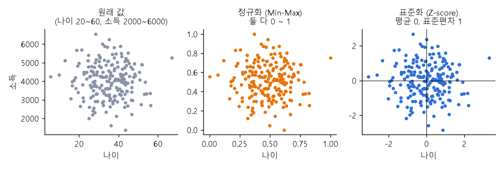

# 03 | 데이터 전처리 용어

@goals
- 전처리가 왜 필요한지 설명한다.
- 정규화와 표준화의 차이를 그림으로 안다.
- 원-핫 인코딩과 레이블 인코딩을 구분해 쓴다.
- 병합·그룹화·집계·피처 엔지니어링을 pandas 로 해 본다.
- 데이터 누수를 피하는 법을 안다.
@end

## 03.1 | 전처리 · Preprocessing
@term Preprocessing | 데이터를 분석하기 알맞게 다듬는 일

받은 데이터를 **분석·학습하기 좋게 다듬는** 모든 작업이에요. 결측치 처리, 이상치 처리, 중복 제거, 자료형 바꾸기, 스케일 맞추기, 인코딩이 다 포함돼요. 실무에서는 분석 시간의 **절반 이상**이 전처리라고 할 만큼 중요해요.

> 💡 비유: 요리 전에 **재료 손질**(씻고, 다듬고, 썰기)을 하는 것과 같아요. 손질이 엉망이면 요리도 엉망이에요. (Garbage in, garbage out)

## 03.2 | 정규화 · Normalization
@term Normalization | 값을 일정한 범위(보통 0~1)로 바꾸는 일

값을 **0 ~ 1 사이로 줄이고 늘리는** 거예요(Min-Max 스케일링). 가장 작은 값은 0, 가장 큰 값은 1 이 돼요.

공식: (x - 최솟값) / (최댓값 - 최솟값)



```python
import pandas as pd
age = pd.Series([20, 30, 40, 60])
print(((age - age.min()) / (age.max() - age.min())).tolist())
```

> 💡 왜 필요할까? 나이(20~60)와 소득(2000~6000만)을 그대로 쓰면 숫자가 큰 소득이 결과를 좌지우지해요. 범위를 맞춰 **공평하게** 비교하게 해요. (거리를 쓰는 KNN·K-Means 에서 특히 중요)

## 03.3 | 표준화 · Standardization
@term Standardization | 평균 0, 표준편차 1 이 되도록 바꾸는 일

각 값에서 평균을 빼고 표준편차로 나눠 **평균 0, 표준편차 1** 로 맞추는 거예요(Z-score). 결과값은 "평균에서 표준편차 몇 개만큼 떨어졌나"를 뜻해요.

공식: (x - 평균) / 표준편차

```python
z = (age - age.mean()) / age.std(ddof=0)
print(z.round(2).tolist(), round(z.mean(), 2), round(z.std(ddof=0), 2))
```

| 구분 | 정규화 (Min-Max) | 표준화 (Z-score) |
|---|---|---|
| 기준 | **범위** 기준 (크기 맞추기) | **평균** 기준 (위치·흩어짐 맞추기) |
| 결과 범위 | 0 ~ 1 | 대략 -3 ~ 3 (제한 없음) |
| 이상치 | 크게 영향받음 | 덜 영향받음 |
| sklearn | MinMaxScaler | StandardScaler |

## 03.4 | 인코딩 · Encoding
@term Encoding | 범주형 데이터를 숫자로 바꾸는 일

컴퓨터 모델은 **숫자만** 계산할 수 있어서, "서울/부산", "남/여" 같은 글자를 숫자로 바꿔야 해요. 대표적인 방법이 원-핫 인코딩과 레이블 인코딩이에요.

## 03.5 | 원-핫 인코딩 · One-Hot Encoding
@term One-Hot Encoding | 범주마다 0과 1로 된 열을 만드는 방법

범주 하나하나를 **새 열**로 만들고, 해당하면 1(또는 True), 아니면 0 을 넣어요. 순서가 없는 범주(지역, 색상)에 알맞아요.

```python
city = pd.DataFrame({"도시": ["서울", "부산", "서울", "대구"]})
print(pd.get_dummies(city, columns=["도시"], dtype=int))
```

> 💡 범주가 아주 많으면(예: 상품 1만 개) 열이 너무 많아져요. 그럴 땐 자주 나오는 것만 남기거나 다른 방법을 써요.

## 03.6 | 레이블 인코딩 · Label Encoding
@term Label Encoding | 범주를 0, 1, 2 같은 정수로 바꾸는 방법

범주마다 **정수 번호**를 붙여요. 열이 늘지 않아 간단하지만, 모델이 숫자 크기(2 > 1)를 **순서로 오해**할 수 있어요. 그래서 **순서가 있는 범주**(낮음·보통·높음)나 트리 모델에 주로 써요.

```python
level = pd.Series(["낮음", "높음", "보통", "낮음"])
print(level.map({"낮음": 0, "보통": 1, "높음": 2}).tolist())   # 순서를 직접 정해 주기
```

## 03.7 | 데이터 병합 · Merge / Join
@term Merge / Join | 여러 데이터를 공통 키로 이어 붙이는 일

두 표를 **공통 열(키)** 로 이어 붙여요. 주문 표에는 고객번호만 있고 고객 이름은 고객 표에 있을 때, 고객번호로 합치면 한 표에서 볼 수 있어요. SQL 의 JOIN 과 같아요.

```python
orders = pd.DataFrame({"고객번호": [1, 2, 1], "금액": [5000, 3000, 7000]})
customers = pd.DataFrame({"고객번호": [1, 2], "이름": ["김파이", "이코딩"]})
print(pd.merge(orders, customers, on="고객번호", how="left"))
```

> 💡 `how` 로 합치는 방식을 정해요: inner(양쪽에 다 있는 것만), left(왼쪽 표 전부), outer(양쪽 전부).

## 03.8 | 그룹화 · Grouping
@term Grouping | 특정 기준으로 데이터를 묶는 일

같은 값끼리 **묶는** 거예요. "도시별", "월별", "성별" 처럼 기준을 정해 나눠요. 그룹화만 하면 결과가 안 보이고, 보통 바로 **집계**와 함께 써요.

## 03.9 | 집계 · Aggregation
@term Aggregation | 여러 값을 모아 합계·평균·개수 등 하나로 요약

여러 값을 **하나의 숫자로 요약**해요: 합계(sum), 평균(mean), 개수(count), 최댓값(max), 최솟값(min).

```python
sales = pd.DataFrame({"도시": ["서울", "부산", "서울", "부산", "서울"], "매출": [100, 80, 120, 60, 90]})
print(sales.groupby("도시")["매출"].agg(["sum", "mean", "count"]))   # 그룹화 + 집계
```

> 💡 "도시별 평균 매출" = 도시로 **그룹화** 하고, 매출을 평균으로 **집계**. SQL 의 `GROUP BY` 와 같아요.

## 03.10 | 피처 엔지니어링 · Feature Engineering
@term Feature Engineering | 예측에 도움이 되는 새 변수를 만드는 일

원래 데이터를 가공해 **모델에 더 도움이 되는 새 피처**를 만드는 거예요. 좋은 피처 하나가 복잡한 모델보다 효과가 클 때가 많아요.

```python
d = pd.DataFrame({"주문일": pd.to_datetime(["2026-11-01", "2026-11-07"]), "총액": [30000, 12000], "수량": [3, 4]})
d["요일"] = d["주문일"].dt.day_name()        # 날짜 → 요일
d["주말"] = d["주문일"].dt.dayofweek >= 5    # 주말 여부
d["개당가격"] = d["총액"] / d["수량"]          # 두 열로 새 열
print(d)
```

## 03.11 | 데이터 누수 · Data Leakage
@term Data Leakage | 학습에 쓰면 안 되는 정보가 모델에 섞여 들어가는 문제

모델이 **실제로 예측할 때는 알 수 없는 정보**를 학습에 써 버리는 실수예요. 학습 점수는 엄청 좋게 나오는데, 실제로 쓰면 형편없어요.

- 예 ① "환불 여부"를 예측하는데 **환불 처리일** 칼럼을 피처로 넣음 (환불돼야 생기는 값)
- 예 ② 전체 데이터로 평균·표준편차를 구해 표준화한 뒤 훈련/테스트를 나눔 (테스트 정보가 섞임)

!> 막는 법: **먼저 훈련/테스트를 나누고**, 표준화·결측치 채우기 기준은 **훈련 데이터로만** 정해요. 예측 시점에 알 수 없는 칼럼은 빼요.

> 💡 비유: 시험 전에 **정답지를 본** 학생이에요. 모의고사는 100점이지만 진짜 시험에서는 실력이 드러나요.

@quiz
? 값을 0 ~ 1 범위로 맞추는 방법은?
+ 정규화 (Min-Max)
- 표준화 (Z-score)
- 원-핫 인코딩
- 집계
= (x - 최솟값) / (최댓값 - 최솟값) 으로 0~1 로 맞춰요.
? 표준화 후 데이터의 평균과 표준편차는?
- 0, 0
+ 0, 1
- 1, 0
- 0.5, 1
= 표준화(Z-score)는 평균 0, 표준편차 1 로 바꿔요.
? 순서가 없는 '도시' 열을 모델에 넣을 때 알맞은 방법은?
- 레이블 인코딩
+ 원-핫 인코딩
- 표준화
- 삭제
= 순서가 없는 범주는 원-핫 인코딩이 숫자 크기 오해를 막아요.
? '도시별 평균 매출'을 구하는 pandas 코드는?
- df.merge("도시")
+ df.groupby("도시")["매출"].mean()
- df.sort_values("매출")
- df.dropna()
= groupby 로 그룹화하고 mean 으로 집계해요.
? 데이터 누수를 막는 올바른 순서는?
- 전체를 표준화 → 훈련/테스트 분리
+ 훈련/테스트 분리 → 훈련 데이터 기준으로 표준화
- 테스트 데이터로 표준화 기준 정하기
- 상관없다
= 기준은 훈련 데이터로만 정해야 테스트 정보가 섞이지 않아요.
@end
