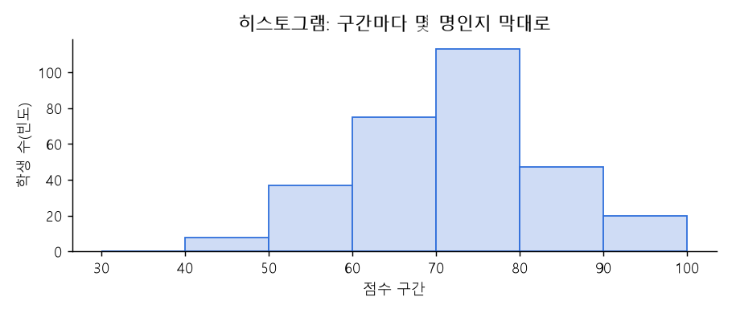
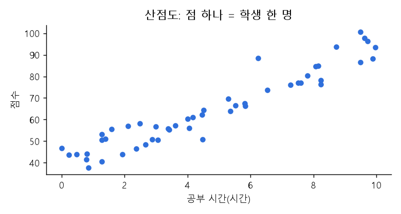
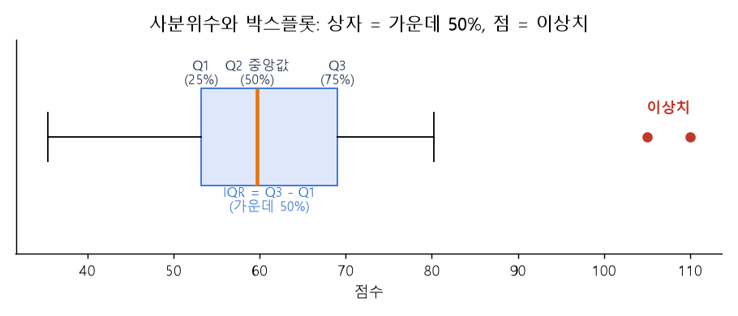
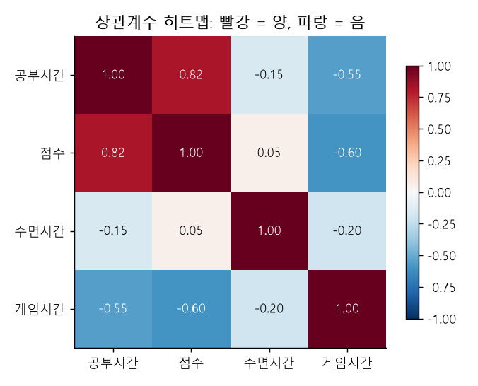

# 04 | 탐색적 데이터 분석(EDA) 용어

@goals
- EDA 가 무엇이고 왜 먼저 하는지 안다.
- 분포·히스토그램·산점도·박스플롯·히트맵을 보고 읽을 수 있다.
- 상관분석과 교차표로 변수 사이의 관계를 확인한다.
@end

## 04.0 | 들어가며: 탐색적 데이터 분석 · EDA
@term EDA | Exploratory Data Analysis, 데이터를 여러 각도로 살펴보는 첫 분석

**EDA**(Exploratory Data Analysis)는 모델을 만들기 전에 **데이터를 요리조리 살펴보는** 단계예요. 요약 통계를 보고, 그래프를 그리고, "이상한 값은 없나? 어떤 변수끼리 관계가 있나?"를 찾아요.

> 💡 비유: 여행 가기 전에 **지도를 펼쳐 보는 것**이에요. 길이 어떻게 생겼는지 알아야 어디로 갈지 정할 수 있어요.

```python
import pandas as pd
import numpy as np

rng = np.random.default_rng(1)
# 학생 100명 가상 데이터
df = pd.DataFrame({
    "공부시간": rng.integers(0, 10, 100),
    "반": rng.choice(["A", "B"], 100),
})
df["점수"] = (50 + df["공부시간"] * 4 + rng.normal(0, 6, 100)).round()
print(df.head())         # 앞 5줄 보기
print(df.describe())     # 수치형 요약
```

## 04.1 | 분포 · Distribution
@term Distribution | 데이터 값들이 어떻게 퍼져 있는지 나타낸 모양

값들이 **어디에 많이 모여 있고 어디에 적은지**를 보여 주는 모양이에요. 가운데 몰려 있는지(정규분포), 한쪽으로 치우쳤는지(왜도), 봉우리가 두 개인지 등을 봐요. 분포는 주로 히스토그램으로 확인해요.

```python
print(df["점수"].value_counts(bins=5).sort_index())   # 구간별 개수 = 분포를 숫자로
```

## 04.2 | 히스토그램 · Histogram
@term Histogram | 구간별 데이터 개수를 막대로 나타낸 그래프

값의 범위를 **구간(bin)** 으로 나누고, 구간마다 **몇 개 있는지** 막대로 그려요. 분포 모양을 한눈에 볼 수 있어요. 막대 사이가 붙어 있는 게 막대그래프와 다른 점이에요(연속된 숫자 구간이라서).



```python
import matplotlib
matplotlib.use("Agg")                # 화면 없이 그림만 만들기
import matplotlib.pyplot as plt
plt.hist(df["점수"], bins=10)        # 10개 구간으로 나눠 개수 세기
plt.show()                           # 앱에서는 결과 창에 그림이 나와요
print("히스토그램 완성")
```

> 💡 구간 수(bins)가 너무 적으면 뭉개지고, 너무 많으면 들쭉날쭉해요. 몇 가지로 바꿔 보며 봐요.

## 04.3 | 산점도 · Scatter Plot
@term Scatter Plot | 두 수치형 변수의 관계를 점으로 찍은 그래프

가로축에 한 변수, 세로축에 다른 변수를 놓고 **관측치마다 점 하나**를 찍어요. 점들이 오른쪽 위로 올라가면 양의 관계, 내려가면 음의 관계, 흩어져 있으면 관계가 약해요. 이상치도 잘 보여요.



```python
plt.figure()
plt.scatter(df["공부시간"], df["점수"])
plt.xlabel("study"); plt.ylabel("score")
plt.show()
print("산점도 완성")
```

## 04.4 | 박스플롯 · Box Plot
@term Box Plot | 사분위수와 이상치를 상자 모양으로 나타낸 그래프

**상자**는 Q1~Q3(가운데 50%), 상자 안의 **선**은 중앙값, 위아래 **수염**은 일반적인 범위, 수염 밖의 **점**은 이상치예요. 여러 그룹의 분포를 나란히 비교할 때 좋아요.



```python
print(df.groupby("반")["점수"].describe()[["25%", "50%", "75%"]])   # 박스플롯이 보여 주는 숫자
```

## 04.5 | 히트맵 · Heatmap
@term Heatmap | 숫자 크기를 색의 진하기로 나타낸 표 그래프

표의 숫자를 **색깔**로 바꿔 보여 줘요. 진할수록 값이 커요. 변수가 많을 때 **상관계수 표**를 히트맵으로 그리면 어떤 변수끼리 관계가 큰지 금방 찾을 수 있어요.



## 04.6 | 상관분석 · Correlation Analysis
@term Correlation Analysis | 변수들 사이의 관계 정도를 분석하는 것

여러 변수 사이의 **상관계수를 한꺼번에 구해** 관계를 살펴보는 분석이에요. `df.corr()` 한 줄로 상관계수 표(상관행렬)가 나와요.

```python
num = df[["공부시간", "점수"]]
print(num.corr().round(2))          # 대각선은 자기 자신과의 상관이라 항상 1
```

!> 상관계수는 **직선 관계**만 잡아요. U자 모양처럼 휘어진 관계는 상관계수가 0 에 가까워도 관계가 있을 수 있으니 꼭 산점도와 함께 봐요.

## 04.7 | 교차표 · Crosstab
@term Crosstab | 두 범주형 변수의 조합별 개수를 센 표

두 **범주형** 변수를 가로·세로로 놓고, 칸마다 **몇 개인지** 센 표예요. "반별로 합격자가 몇 명?" 같은 질문에 답해요. 엑셀의 피벗 테이블과 비슷해요.

```python
df["합격"] = np.where(df["점수"] >= 70, "합격", "불합격")
print(pd.crosstab(df["반"], df["합격"]))                         # 개수
print(pd.crosstab(df["반"], df["합격"], normalize="index").round(2))   # 반별 비율
```

@quiz
? 모델을 만들기 전에 데이터를 그래프와 통계로 살펴보는 단계는?
+ EDA
- 하이퍼파라미터
- 과적합
- 인코딩
= EDA(탐색적 데이터 분석)예요.
? 한 변수의 분포 모양을 보기에 가장 알맞은 그래프는?
+ 히스토그램
- 산점도
- 교차표
- 히트맵
= 히스토그램은 구간별 개수로 분포를 보여 줘요.
? 두 수치형 변수의 관계를 점으로 찍은 그래프는?
- 박스플롯
+ 산점도
- 히스토그램
- 파이차트
= 산점도(scatter)예요.
? 박스플롯에서 상자 안의 선은?
- 평균
+ 중앙값
- 최댓값
- 최빈값
= 상자 안의 선은 중앙값(Q2)이에요.
? '반'과 '합격 여부' 두 범주형 변수의 조합별 개수를 세는 표는?
- 상관행렬
+ 교차표
- 히스토그램
- 산점도
= pd.crosstab 으로 만드는 교차표예요.
@end
