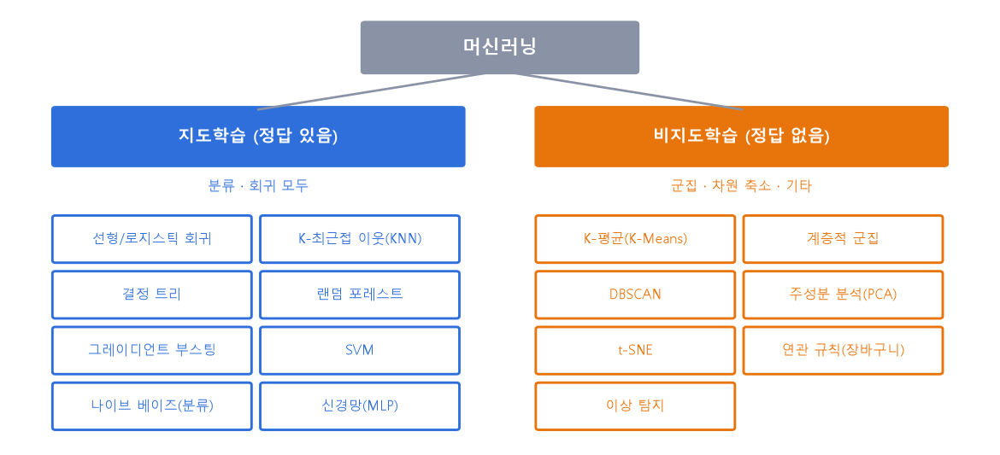
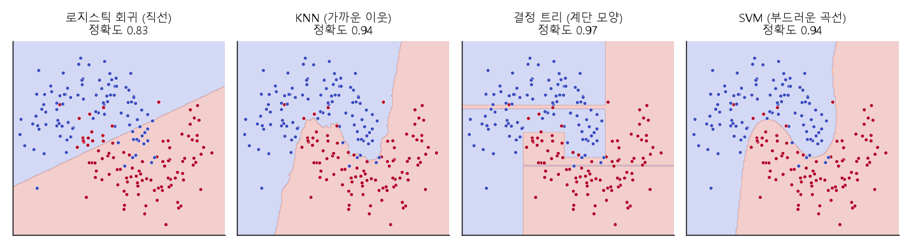
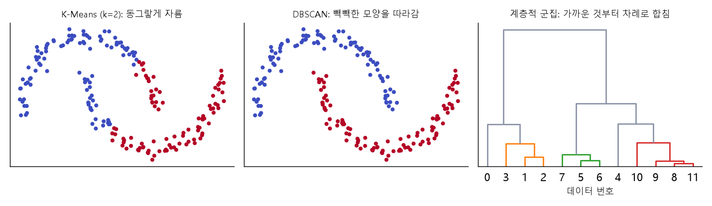
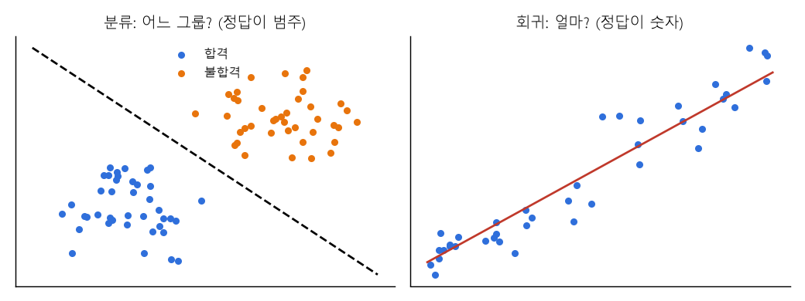
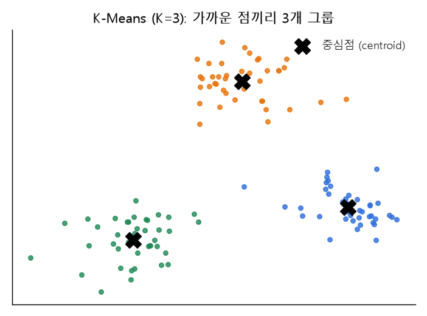
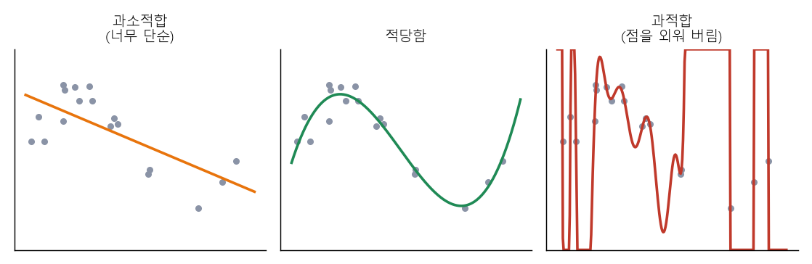

# 05 | 머신러닝 기초 용어

@goals
- 지도학습과 비지도학습을 구분하고, 각각의 대표 모델을 말할 수 있다.
- 분류·회귀·군집화·차원 축소가 각각 어떤 문제를 푸는지 안다.
- 훈련·검증·테스트 데이터를 나누는 이유를 안다.
- 과적합·과소적합·하이퍼파라미터의 뜻을 그림으로 이해한다.
@end

## 05.0 | 들어가며: 머신러닝이란?
@term Machine Learning | 데이터에서 규칙을 스스로 찾아내는 방법

사람이 규칙을 일일이 코딩하는 대신, **데이터를 보여 주면 컴퓨터가 규칙을 찾아내는** 방법이에요. 스팸 메일 규칙을 사람이 다 적는 대신, 스팸/정상 메일 수천 개를 보여 주고 스스로 구별법을 배우게 해요.

> 💡 학습한 결과물(찾아낸 규칙)을 **모델(model)** 이라고 해요. 모델에 새 데이터를 넣어 답을 얻는 것을 **예측(predict)** 이라 해요.

## 05.1 | 지도학습 · Supervised Learning
@term Supervised Learning | 정답(레이블)이 있는 데이터로 학습하는 방법

**문제와 정답을 함께** 주고 배우게 해요. 피처(X)와 타깃(y)이 둘 다 있어요. 대표적으로 **분류**(정답이 범주: 어느 칸?)와 **회귀**(정답이 숫자: 얼마?)가 있어요. (자세한 뜻은 05.3·05.4)

> 💡 비유: 선생님이 **답지가 있는 문제집**으로 가르치는 것. 틀리면 정답을 보고 고쳐요.



지도학습의 대표 모델 9가지를 아래 **05.1.1 ~ 05.1.9** 에서 하나씩 소개해요. 예제는 모두 붓꽃(iris) 데이터로 같은 문제를 풀어서 정확도를 비교해 볼 수 있게 했어요.

```python
from sklearn.datasets import load_iris
from sklearn.model_selection import train_test_split

# 붓꽃 150송이: 꽃잎·꽃받침 길이와 너비(피처 4개) → 품종 3가지(타깃)
X, y = load_iris(return_X_y=True)
X_tr, X_te, y_tr, y_te = train_test_split(X, y, test_size=0.3, random_state=0)
print(X_tr.shape, X_te.shape)       # 훈련 105송이, 테스트 45송이
```



## 05.1.1 | 선형 회귀 · Linear Regression
@term Linear Regression | 직선(y = ax + b)으로 숫자를 예측하는 가장 기본 회귀 모델

피처와 타깃 사이에 **곧은 직선** 관계가 있다고 보고, 가장 잘 맞는 직선을 찾아 **숫자를 예측**해요. 집값, 매출 예측의 출발점이에요. 계수(기울기)를 보면 "어떤 피처가 얼마나 영향을 주는지" 설명할 수 있어서 해석하기 쉬워요. (10장에서 더 자세히)

- 쓰는 곳: 회귀 · 장점: 빠르고 설명하기 쉬움 · 단점: 휘어진 관계는 못 잡음

```python
from sklearn.linear_model import LinearRegression
# 꽃잎 길이(2번 열)로 꽃잎 너비(3번 열) 예측하기
reg = LinearRegression().fit(X_tr[:, [2]], X_tr[:, 3])
print("기울기", reg.coef_.round(3), "절편", round(reg.intercept_, 3))
print("R² =", round(reg.score(X_te[:, [2]], X_te[:, 3]), 3))
```

## 05.1.2 | 로지스틱 회귀 · Logistic Regression
@term Logistic Regression | 확률(0~1)을 계산해 범주를 고르는 분류 모델

이름에 '회귀'가 있지만 **분류 모델**이에요. 직선 계산 결과를 **S자 곡선(시그모이드)** 에 넣어 0~1 사이의 **확률**로 바꾸고, 확률이 높은 쪽을 정답으로 골라요. "합격 확률 83%" 처럼 확률을 함께 알려 줘요.

- 쓰는 곳: 분류 (스팸, 이탈 예측) · 장점: 빠르고 확률을 줌 · 단점: 경계가 직선이라 복잡한 모양은 약함

```python
from sklearn.linear_model import LogisticRegression
m = LogisticRegression(max_iter=1000).fit(X_tr, y_tr)
print("정확도", round(m.score(X_te, y_te), 3))
print("첫 꽃의 품종별 확률", m.predict_proba(X_te[:1]).round(2))
```

## 05.1.3 | K-최근접 이웃 · KNN
@term KNN | K-Nearest Neighbors, 가장 가까운 이웃 K개의 다수결로 예측

새 데이터와 **가장 가까운 이웃 K개**를 찾아서, 이웃들이 가장 많이 속한 쪽으로 정해요(분류). 회귀에서는 이웃 값의 평균을 써요. 따로 "공부"하지 않고 데이터를 외워 두었다가 물어볼 때 비교해요.

> 💡 비유: 이사 온 동네에서 **가까운 이웃 5집**이 다 짜장면을 시키면 나도 짜장면 집을 고르는 것.

- 장점: 이해하기 쉬움 · 단점: 데이터가 많으면 느림, 거리를 쓰니 **표준화**가 꼭 필요

```python
from sklearn.neighbors import KNeighborsClassifier
for k in [1, 5, 15]:                     # K(이웃 수)는 하이퍼파라미터
    m = KNeighborsClassifier(n_neighbors=k).fit(X_tr, y_tr)
    print("K =", k, "정확도", round(m.score(X_te, y_te), 3))
```

## 05.1.4 | 결정 트리 · Decision Tree
@term Decision Tree | 예/아니오 질문을 이어 가며 답을 찾는 나무 모양 모델

"꽃잎 길이가 2.5cm 보다 작은가?" 같은 **예/아니오 질문**을 차례로 던져 가지를 나누고, 마지막 잎(leaf)에서 답을 정해요. 스무고개와 같아요. 규칙을 사람이 그대로 읽을 수 있어서 **설명하기 좋아요.**

- 장점: 해석 쉬움, 표준화 필요 없음 · 단점: 깊게 만들면 **과적합**되기 쉬움 (max_depth 로 조절)

```python
from sklearn.tree import DecisionTreeClassifier, export_text
tree = DecisionTreeClassifier(max_depth=2, random_state=0).fit(X_tr, y_tr)
print("정확도", round(tree.score(X_te, y_te), 3))
print(export_text(tree, feature_names=["꽃받침길이", "꽃받침너비", "꽃잎길이", "꽃잎너비"]))   # 질문 규칙 보기
```

## 05.1.5 | 랜덤 포레스트 · Random Forest
@term Random Forest | 결정 트리 여러 그루의 투표로 예측하는 앙상블 모델

결정 트리를 **수백 그루** 만들어 **투표(다수결)** 로 정해요. 나무마다 데이터와 피처를 **무작위(random)** 로 조금씩 다르게 줘서, 한 나무의 실수를 다른 나무들이 바로잡아요. 이렇게 여러 모델을 합치는 방법을 **앙상블(ensemble)** 이라 해요.

> 💡 비유: 한 명의 의견보다 **여러 사람의 투표**가 더 믿을 만한 것과 같아요.

- 장점: 성능이 좋고 과적합에 강함, 피처 중요도를 알려 줌 · 단점: 나무가 많아 규칙을 한눈에 읽기 어려움

```python
from sklearn.ensemble import RandomForestClassifier
rf = RandomForestClassifier(n_estimators=100, random_state=0).fit(X_tr, y_tr)
print("정확도", round(rf.score(X_te, y_te), 3))
print("피처 중요도", rf.feature_importances_.round(2))   # 꽃잎 길이·너비가 중요
```

## 05.1.6 | 그레이디언트 부스팅 · Gradient Boosting
@term Gradient Boosting | 앞 나무가 틀린 부분을 다음 나무가 고쳐 가며 쌓는 앙상블 모델

랜덤 포레스트가 나무들을 **동시에 따로** 만든다면, 부스팅은 나무를 **차례로** 만들어요. 다음 나무는 **앞 나무들이 틀린 부분**을 집중해서 고쳐요. 표 형태 데이터에서 가장 성능이 좋은 편이라 대회·실무에서 많이 써요. **XGBoost, LightGBM, CatBoost** 가 유명한 부스팅 라이브러리예요.

> 💡 비유: 오답 노트를 보며 **틀린 문제만 다시 공부**하기를 반복하는 것.

```python
from sklearn.ensemble import GradientBoostingClassifier
gb = GradientBoostingClassifier(random_state=0).fit(X_tr, y_tr)
print("정확도", round(gb.score(X_te, y_te), 3))
```

## 05.1.7 | 서포트 벡터 머신 · SVM
@term SVM | Support Vector Machine, 두 그룹 사이의 간격(여백)이 가장 넓은 경계를 찾는 모델

두 그룹을 나누는 선 중에서 **양쪽과의 간격(margin)이 가장 넓은 선**을 골라요. 경계에 가장 가까운 점들을 **서포트 벡터**라 불러요. **커널(kernel)** 이라는 기법으로 휘어진 경계도 만들 수 있어요.

> 💡 비유: 두 마을 사이에 길을 낼 때 **양쪽 집에서 최대한 멀리** 넓은 도로를 내는 것.

- 장점: 데이터가 많지 않을 때 성능 좋음 · 단점: 데이터가 아주 많으면 느림, 표준화 필요

```python
from sklearn.svm import SVC
svm = SVC(kernel="rbf").fit(X_tr, y_tr)
print("정확도", round(svm.score(X_te, y_te), 3))
```

## 05.1.8 | 나이브 베이즈 · Naive Bayes
@term Naive Bayes | 확률(베이즈 정리)로 가장 그럴듯한 범주를 고르는 분류 모델

"이 단어들이 나왔을 때 스팸일 확률은?"처럼 **확률을 계산**해 가장 가능성이 높은 범주를 골라요. 피처들이 서로 **관계없다고 단순하게(naive, 순진하게) 가정**해서 계산이 아주 빨라요. 스팸 메일·문서 분류에 많이 써요.

```python
from sklearn.naive_bayes import GaussianNB
nb = GaussianNB().fit(X_tr, y_tr)
print("정확도", round(nb.score(X_te, y_te), 3))
```

## 05.1.9 | 신경망 · Neural Network
@term Neural Network | 뇌의 신경세포를 본뜬 층(layer)을 쌓아 복잡한 패턴을 배우는 모델

입력 → **여러 층의 노드(뉴런)** → 출력으로 이어진 모델이에요. 층마다 숫자를 곱하고 더하며 복잡한 관계를 배워요. 층을 아주 깊게 쌓은 것이 **딥러닝**이고, 사진·음성·글(ChatGPT 등)에 강해요. sklearn 의 `MLPClassifier`(다층 퍼셉트론)로 간단히 써 볼 수 있어요.

- 장점: 아주 복잡한 패턴도 학습 · 단점: 데이터와 계산이 많이 필요, 왜 그렇게 답했는지 설명하기 어려움

```python
from sklearn.neural_network import MLPClassifier
from sklearn.preprocessing import StandardScaler
sc = StandardScaler().fit(X_tr)                      # 신경망은 표준화가 중요
mlp = MLPClassifier(hidden_layer_sizes=(10,), max_iter=2000, random_state=0).fit(sc.transform(X_tr), y_tr)
print("정확도", round(mlp.score(sc.transform(X_te), y_te), 3))
```

| 모델 | 분류 | 회귀 | 한 줄 특징 |
|---|---|---|---|
| 선형 회귀 | - | ○ | 직선, 해석 쉬움 |
| 로지스틱 회귀 | ○ | - | 확률을 주는 분류 기본 모델 |
| KNN | ○ | ○ | 가까운 이웃 다수결 |
| 결정 트리 | ○ | ○ | 예/아니오 질문, 설명 쉬움 |
| 랜덤 포레스트 | ○ | ○ | 나무 여러 그루 투표 |
| 그레이디언트 부스팅 | ○ | ○ | 틀린 것 고쳐 가며 쌓기, 성능 최상위 |
| SVM | ○ | ○ | 간격이 가장 넓은 경계 |
| 나이브 베이즈 | ○ | - | 확률 계산, 아주 빠름 |
| 신경망 | ○ | ○ | 층을 쌓아 복잡한 패턴 |

> 💡 처음에는 **로지스틱 회귀(또는 선형 회귀)로 기준 점수**를 내고, **랜덤 포레스트·부스팅**으로 올려 보는 순서를 많이 써요. 회귀용은 이름 끝이 Regressor 예요 (예: `RandomForestRegressor`).

## 05.2 | 비지도학습 · Unsupervised Learning
@term Unsupervised Learning | 정답 없이 데이터 속 구조를 찾는 방법

**정답 없이** 데이터만 주고, 비슷한 것끼리 묶거나 숨은 구조를 찾게 해요. 대표적으로 **군집화**와 **차원 축소**가 있어요.

> 💡 비유: 정답 없이 사진 1000장을 주고 "비슷한 것끼리 나눠 봐" 하는 것. 컴퓨터가 알아서 고양이끼리, 강아지끼리 묶어요(이름은 몰라도).

비지도학습의 대표 모델 7가지를 아래 **05.2.1 ~ 05.2.7** 에서 소개해요. 붓꽃 데이터에서 **정답(품종)은 빼고** 피처만 써요.

```python
from sklearn.datasets import load_iris
from sklearn.preprocessing import StandardScaler
X, y = load_iris(return_X_y=True)          # y(품종)는 나중에 '맞게 묶였나' 확인할 때만 사용
Xs = StandardScaler().fit_transform(X)      # 거리를 쓰는 모델이 많아 표준화
print(Xs.shape)
```



## 05.2.1 | K-평균 군집 · K-Means
@term K-Means | 중심점 K개를 기준으로 가까운 데이터끼리 묶는 군집 모델

그룹 수 **K** 를 정해 주면, 중심점을 놓고 → 가까운 점을 묶고 → 중심을 평균 위치로 옮기기를 반복해요. 가장 많이 쓰는 군집 모델이에요. (10장 KMeans·Elbow 에서 자세히)

- 장점: 빠르고 간단 · 단점: K 를 미리 정해야 함, 동그란 모양의 무리만 잘 찾음

```python
from sklearn.cluster import KMeans
import pandas as pd
km = KMeans(n_clusters=3, n_init=10, random_state=0).fit(Xs)
print(pd.crosstab(km.labels_, y, rownames=["군집"], colnames=["실제 품종"]))   # 정답과 비교
```

## 05.2.2 | 계층적 군집 · Hierarchical Clustering
@term Hierarchical Clustering | 가장 가까운 것부터 차례로 합쳐 나무 모양(덴드로그램)을 만드는 군집

처음엔 데이터 하나하나가 각자 그룹이에요. **가장 가까운 두 그룹을 합치기**를 계속해서 결국 하나가 될 때까지 쌓아요. 그 과정을 그린 나무 그림이 **덴드로그램**이고, 원하는 높이에서 잘라 그룹 수를 정해요.

> 💡 비유: 족보(가계도)처럼 가까운 친척부터 묶어 올라가는 것.

```python
from sklearn.cluster import AgglomerativeClustering
hc = AgglomerativeClustering(n_clusters=3).fit(Xs)
print(pd.Series(hc.labels_).value_counts().sort_index().tolist())   # 군집별 개수
```

## 05.2.3 | DBSCAN
@term DBSCAN | 점이 빽빽하게 모인 곳을 따라 묶고, 외딴 점은 이상치로 남기는 군집

**점이 빽빽한(밀도가 높은) 곳**을 이어 가며 하나의 군집으로 묶어요. K 를 정하지 않아도 되고, **초승달처럼 휜 모양**도 잘 찾아요. 어디에도 속하지 않는 외딴 점은 **-1(잡음, 이상치)** 로 표시해요.

- 하이퍼파라미터: `eps`(이웃으로 볼 거리), `min_samples`(빽빽하다고 볼 최소 점 수)

```python
from sklearn.cluster import DBSCAN
db = DBSCAN(eps=0.6, min_samples=5).fit(Xs)
print(sorted(set(db.labels_.tolist())))           # -1 은 잡음(이상치)
print("잡음으로 본 점:", (db.labels_ == -1).sum(), "개")
```

## 05.2.4 | 주성분 분석 · PCA
@term PCA | Principal Component Analysis, 정보를 가장 많이 담은 새 축으로 차원을 줄이는 방법

여러 피처를 섞어서 **정보(분산)를 가장 많이 담는 새 축(주성분)** 을 만들고, 중요한 축 몇 개만 남겨 차원을 줄여요. 피처 4개를 2개로 줄여 **그래프로 그려 보거나**, 모델을 가볍게 할 때 써요.

```python
from sklearn.decomposition import PCA
pca = PCA(n_components=2).fit(Xs)
print("주성분 2개가 담은 정보 비율", pca.explained_variance_ratio_.round(3), "합계", round(pca.explained_variance_ratio_.sum(), 3))
```

## 05.2.5 | t-SNE
@term t-SNE | 고차원 데이터를 2~3차원 그림으로 보여 주는 시각화용 차원 축소

고차원에서 **가까웠던 점은 그림에서도 가깝게** 놓이도록 2차원(또는 3차원)으로 펼쳐요. 비슷한 데이터가 덩어리로 보여서 **눈으로 군집을 확인**할 때 좋아요. 다만 계산이 느리고 축 자체에는 뜻이 없어서, 모델 입력보다는 **그림 그리기용**으로 써요.

```python
from sklearn.manifold import TSNE
emb = TSNE(n_components=2, perplexity=30, random_state=0).fit_transform(Xs)
print(emb.shape)            # 150개 점 → 2차원 좌표
```

## 05.2.6 | 연관 규칙 · Association Rules
@term Association Rules | "A를 사면 B도 산다" 같은 함께 일어나는 규칙을 찾는 방법

장바구니 데이터에서 **함께 자주 사는 상품 규칙**을 찾아요(장바구니 분석). 세 가지 숫자로 규칙을 평가해요.

- **지지도(support)**: A와 B를 함께 산 비율 (얼마나 흔한가)
- **신뢰도(confidence)**: A를 산 사람 중 B도 산 비율
- **향상도(lift)**: 신뢰도 ÷ B 구매율. **1보다 크면** A가 B 구매를 끌어올린다는 뜻

```python
baskets = pd.DataFrame({            # 1 = 구매, 0 = 구매 안 함 (장바구니 6개)
    "빵":  [1, 1, 1, 0, 1, 1],
    "우유": [1, 1, 0, 1, 1, 0],
    "잼":  [1, 0, 1, 0, 1, 1],
})
both = (baskets["빵"] & baskets["잼"]).mean()           # 빵과 잼을 함께 산 비율
conf = both / baskets["빵"].mean()                      # 빵을 산 사람 중 잼도 산 비율
lift = conf / baskets["잼"].mean()
print(f"빵→잼  지지도 {both:.2f}, 신뢰도 {conf:.2f}, 향상도 {lift:.2f}")
```

> 💡 대표 알고리즘은 **Apriori** 예요. "기저귀를 사는 사람이 맥주도 산다" 같은 진열·추천 전략에 써요.

## 05.2.7 | 이상 탐지 · Anomaly Detection
@term Anomaly Detection | 대부분과 다른 드문 데이터(이상치)를 찾아내는 방법

정상 데이터의 패턴을 배우고, 거기서 **크게 벗어난 데이터**를 찾아요. 카드 사기 거래, 공장 설비 고장, 해킹 탐지에 써요. 대표 모델 **Isolation Forest** 는 "몇 번 만에 따로 떼어 낼 수 있나"를 보고, **빨리 고립되는 점일수록 이상치**로 판단해요.

```python
from sklearn.ensemble import IsolationForest
import numpy as np
pay = np.array([[12], [15], [11], [14], [13], [16], [12], [250]])   # 결제 금액(천 원)
iso = IsolationForest(contamination=0.13, random_state=0).fit(pay)
print(iso.predict(pay))      # 1 = 정상, -1 = 이상
```

| 모델 | 하는 일 | 한 줄 특징 |
|---|---|---|
| K-Means | 군집 | K 개 중심점, 빠르고 간단 |
| 계층적 군집 | 군집 | 덴드로그램으로 그룹 수 고르기 |
| DBSCAN | 군집 | 모양 자유, 이상치 표시, K 불필요 |
| PCA | 차원 축소 | 정보를 많이 담은 축만 남기기 |
| t-SNE | 차원 축소 | 그림으로 보기 위한 2차원 펼치기 |
| 연관 규칙 | 규칙 찾기 | 함께 사는 상품 (지지도·신뢰도·향상도) |
| 이상 탐지 | 이상치 찾기 | 사기·고장 탐지, Isolation Forest |

## 05.3 | 분류 · Classification
@term Classification | 정해진 범주 중 하나를 예측하는 문제

정답이 **범주(종류)** 인 문제예요. 스팸/정상, 합격/불합격, 고양이/강아지/새. 답이 "어느 칸에 들어가나?"예요.



```python
from sklearn.tree import DecisionTreeClassifier

# 공부시간, 출석일 → 합격(1)/불합격(0)
X = [[1, 5], [2, 8], [6, 15], [8, 18], [3, 9], [7, 17]]
y = [0, 0, 1, 1, 0, 1]
model = DecisionTreeClassifier(random_state=0).fit(X, y)   # 학습
print(model.predict([[5, 14], [1, 4]]))                    # 새 학생 2명 예측
```

## 05.4 | 회귀 · Regression
@term Regression | 연속된 숫자 값을 예측하는 문제

정답이 **숫자**인 문제예요. 집값, 내일 기온, 매출액처럼 "얼마?"를 맞혀요. (분류: 어느 칸? / 회귀: 얼마?)

```python
from sklearn.linear_model import LinearRegression

X = [[1], [2], [3], [4], [5]]          # 공부시간
y = [55, 62, 68, 74, 81]               # 점수
reg = LinearRegression().fit(X, y)
print(reg.predict([[6]]).round(1))     # 6시간 공부하면 몇 점?
```

> 💡 "회귀"라는 이름의 유래는 9장 Regression 에서 자세히 볼게요.

## 05.5 | 군집화 · Clustering
@term Clustering | 비슷한 데이터끼리 그룹으로 묶는 것

정답 없이 **비슷한 것끼리 그룹(군집)** 으로 묶어요. 고객을 구매 패턴으로 나눠 "알뜰형·충성형·신규형"처럼 마케팅에 써요. 대표 알고리즘이 K-Means(9장)예요.



## 05.6 | 차원 축소 · Dimensionality Reduction
@term Dimensionality Reduction | 변수(차원) 개수를 줄이면서 정보는 최대한 남기는 것

피처(열)가 너무 많을 때 **핵심만 남겨 개수를 줄이는** 거예요. 계산이 빨라지고, 2~3차원으로 줄이면 그래프로 볼 수도 있어요. 대표 방법이 **PCA**(주성분 분석)예요.

```python
from sklearn.decomposition import PCA
import numpy as np

rng = np.random.default_rng(0)
base = rng.normal(size=(50, 1))
X4 = np.hstack([base, base * 2, base + rng.normal(0, 0.1, (50, 1)), rng.normal(size=(50, 1))])  # 4개 열(3개는 비슷)
pca = PCA(n_components=2).fit(X4)
print(pca.explained_variance_ratio_.round(2))   # 2개로 줄여도 정보의 몇 % 가 남나
```

> 💡 비유: 사람을 키·몸무게·발 크기·팔 길이로 설명하는 대신 "체격" 하나로 요약하는 것과 비슷해요.

## 05.7 | 훈련 / 검증 / 테스트 데이터 · Train / Validation / Test
@term Train / Validation / Test | 학습용 / 조정용 / 최종 평가용으로 나눈 데이터

데이터를 세 덩어리로 나눠요.

- **훈련(Train)**: 모델이 **공부하는** 데이터 (교과서)
- **검증(Validation)**: 설정을 **고르고 조정하는** 데이터 (모의고사)
- **테스트(Test)**: 마지막에 **딱 한 번 실력을 재는** 데이터 (수능)


```python
from sklearn.model_selection import train_test_split
data = list(range(100))
train, test = train_test_split(data, test_size=0.2, random_state=42)   # 80 : 20
train, val = train_test_split(train, test_size=0.25, random_state=42)  # 80의 25% = 20
print(len(train), len(val), len(test))
```

!> 테스트 데이터를 보며 모델을 고치면 안 돼요. 그러면 테스트가 "모의고사"가 되어 진짜 실력을 모르게 돼요(데이터 누수의 한 종류).

## 05.8 | 과적합 · Overfitting
@term Overfitting | 훈련 데이터에만 너무 맞춰져 새 데이터에서 성능이 떨어지는 현상

모델이 훈련 데이터를 **통째로 외워 버려서**, 처음 보는 데이터에는 약한 상태예요. 훈련 점수는 높은데 테스트 점수가 낮아요.



> 💡 비유: 기출문제 **답만 외운** 학생. 똑같은 문제는 100점, 숫자만 바꿔도 못 풀어요.

해결: 데이터 더 모으기, 모델을 단순하게, 규제(regularization), 교차 검증.

## 05.9 | 과소적합 · Underfitting
@term Underfitting | 모델이 너무 단순해 데이터의 패턴을 제대로 못 배운 상태

모델이 **너무 단순해서** 훈련 데이터조차 잘 못 맞히는 상태예요. 훈련 점수도, 테스트 점수도 둘 다 낮아요.

> 💡 비유: 공부를 **너무 대충** 한 학생. 쉬운 문제도 틀려요.

해결: 더 복잡한 모델, 더 좋은 피처(피처 엔지니어링), 학습 더 오래.

| 상태 | 훈련 점수 | 테스트 점수 |
|---|---|---|
| 과소적합 | 낮음 | 낮음 |
| 적당함 | 높음 | 높음 (비슷) |
| 과적합 | 매우 높음 | 낮음 (차이 큼) |

## 05.10 | 하이퍼파라미터 · Hyperparameter
@term Hyperparameter | 학습 전에 사람이 정해 주는 모델 설정값

모델이 **스스로 배우는 값이 아니라, 사람이 미리 정하는 설정**이에요. 결정 트리의 최대 깊이(max_depth), K-Means 의 그룹 수(k), 학습률 등이 있어요. 검증 데이터로 여러 값을 시험해 가장 좋은 걸 골라요.

```python
from sklearn.tree import DecisionTreeClassifier
from sklearn.datasets import load_iris
from sklearn.model_selection import train_test_split

X, y = load_iris(return_X_y=True)
X_tr, X_te, y_tr, y_te = train_test_split(X, y, test_size=0.3, random_state=0)
for depth in [1, 2, 3, 10]:                         # 하이퍼파라미터 바꿔 보기
    m = DecisionTreeClassifier(max_depth=depth, random_state=0).fit(X_tr, y_tr)
    print(depth, round(m.score(X_tr, y_tr), 2), round(m.score(X_te, y_te), 2))   # 훈련, 테스트 정확도
```

> 💡 **파라미터**(모델이 배우는 값, 예: 회귀의 기울기) vs **하이퍼파라미터**(사람이 정하는 값). 오븐으로 비유하면 온도·시간은 하이퍼파라미터, 빵이 부푸는 건 모델이 알아서 해요.

@quiz
? 정답(레이블)이 있는 데이터로 학습하는 방법은?
+ 지도학습
- 비지도학습
- 군집화
- 차원 축소
= 문제와 정답을 함께 주는 것이 지도학습이에요.
? '내일 기온 예측'은 어떤 문제인가요?
- 분류
+ 회귀
- 군집화
- 차원 축소
= 정답이 연속된 숫자이면 회귀예요.
? 고객을 정답 없이 비슷한 그룹으로 나누는 것은?
- 분류
- 회귀
+ 군집화
- 테스트
= 정답 없이 비슷한 것끼리 묶는 비지도학습, 군집화예요.
? 훈련 점수 99%, 테스트 점수 60% 라면?
+ 과적합
- 과소적합
- 적당함
- 데이터 누수 없음
= 훈련 데이터만 외운 과적합이에요.
? 다음 중 하이퍼파라미터는?
- 회귀식의 기울기
+ 결정 트리의 max_depth
- 예측 결과
- 타깃 값
= 학습 전에 사람이 정하는 설정값이에요. 기울기는 모델이 배우는 파라미터예요.
? 마지막에 딱 한 번 실력을 재는 데이터는?
- 훈련 데이터
- 검증 데이터
+ 테스트 데이터
- 원본 데이터
= 테스트 데이터는 수능처럼 마지막에 한 번만 써요.
? 결정 트리 여러 그루의 투표로 예측하는 모델은?
- KNN
+ 랜덤 포레스트
- 로지스틱 회귀
- PCA
= 나무(tree)가 모인 숲(forest), 여러 트리의 다수결이에요.
? 다음 중 비지도학습 모델은?
- 로지스틱 회귀
- 서포트 벡터 머신
+ DBSCAN
- 그레이디언트 부스팅
= DBSCAN 은 정답 없이 빽빽한 점끼리 묶는 군집 모델이에요.
? 이름에 '회귀'가 있지만 실제로는 분류에 쓰는 모델은?
+ 로지스틱 회귀
- 선형 회귀
- K-Means
- t-SNE
= 확률을 계산해 범주를 고르는 분류 모델이에요.
@end
