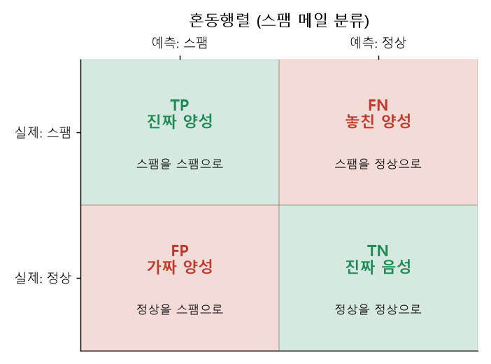
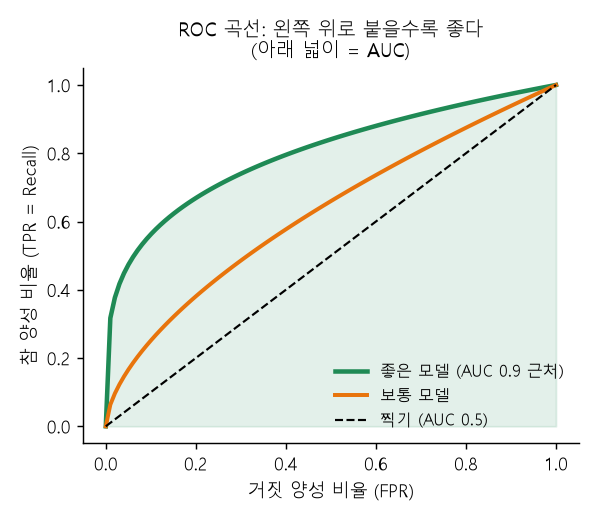

# 06 | 모델 평가 용어

@goals
- 혼동행렬의 TP·FP·FN·TN 을 읽는다.
- 정확도·정밀도·재현율·F1·ROC-AUC 를 언제 쓰는지 안다.
- 회귀 평가 지표 MAE·MSE·RMSE·R² 를 계산하고 해석한다.
@end

## 06.0 | 들어가며: 모델 성적표
모델을 만들었으면 **얼마나 잘 맞히는지** 숫자로 재야 해요. 분류와 회귀는 평가 방법이 달라요.

- **분류**: 맞혔다/틀렸다를 센다 → 정확도, 정밀도, 재현율, F1, ROC-AUC
- **회귀**: 얼마나 차이 나는지 잰다 → MAE, MSE, RMSE, R²

이 장의 분류 예시는 **스팸 메일 필터**예요. 스팸 = 양성(Positive, 1), 정상 = 음성(Negative, 0).

## 06.1 | 혼동행렬 · Confusion Matrix
@term Confusion Matrix | 실제 정답과 예측 결과를 2×2 표로 정리한 것

실제와 예측을 비교해 **네 칸**으로 나눈 표예요.

- **TP** (True Positive): 스팸을 스팸이라고 맞힘 ✅
- **TN** (True Negative): 정상을 정상이라고 맞힘 ✅
- **FP** (False Positive): 정상을 스팸이라고 잘못 판단 ❌ (중요한 메일이 스팸함으로!)
- **FN** (False Negative): 스팸을 정상이라고 놓침 ❌ (스팸이 받은편지함으로)



```python
from sklearn.metrics import confusion_matrix
y_true = [1, 1, 1, 1, 0, 0, 0, 0, 0, 0]   # 실제 (1 = 스팸)
y_pred = [1, 1, 1, 0, 1, 0, 0, 0, 0, 0]   # 모델 예측
print(confusion_matrix(y_true, y_pred))    # [[TN FP] [FN TP]] 순서
```

> 💡 이름 읽는 법: 뒤 글자(P/N)는 **모델이 뭐라고 했나**, 앞 글자(T/F)는 **그게 맞았나**. FP = "양성이라 했는데(P) 틀렸다(F)".

## 06.2 | 정확도 · Accuracy
@term Accuracy | 전체 중 맞힌 비율

전체 예측 중 **맞힌 비율**이에요. (TP + TN) / 전체.

```python
from sklearn.metrics import accuracy_score
print(accuracy_score(y_true, y_pred))     # 10개 중 8개 맞힘
```

!> **데이터가 한쪽으로 쏠리면 정확도가 속여요.** 환자가 1%인 데이터에서 "모두 정상"이라고만 해도 정확도 99%예요. 그래서 정밀도·재현율을 같이 봐요.

## 06.3 | 정밀도 · Precision
@term Precision | 양성이라고 예측한 것 중 진짜 양성의 비율

모델이 **"스팸이다!" 라고 한 것 중 진짜 스팸**의 비율이에요. TP / (TP + FP).

**FP(괜히 양성이라 한 것)가 치명적일 때** 중요해요: 스팸 필터(중요 메일이 스팸함으로 가면 큰일), 유죄 판결.

```python
from sklearn.metrics import precision_score
print(precision_score(y_true, y_pred))    # 스팸이라 한 4개 중 3개가 진짜
```

## 06.4 | 재현율 · Recall
@term Recall | 실제 양성 중 모델이 찾아낸 비율

**실제 스팸 중 모델이 찾아낸** 비율이에요. TP / (TP + FN). 민감도(Sensitivity)라고도 해요.

**FN(놓친 것)이 치명적일 때** 중요해요: 암 진단(환자를 놓치면 큰일), 사기 거래 탐지.

```python
from sklearn.metrics import recall_score
print(recall_score(y_true, y_pred))       # 실제 스팸 4개 중 3개 찾음
```

> 💡 기억법 — 정밀도: "**내가 찍은 것**이 얼마나 정확해?" / 재현율: "**찾아야 할 것**을 얼마나 찾았어?" 둘은 보통 한쪽을 올리면 다른 쪽이 내려가요.

## 06.5 | F1-score
@term F1-score | 정밀도와 재현율의 조화평균

정밀도와 재현율을 **하나로 합친 점수**예요. 조화평균을 써서 **둘 중 하나라도 낮으면 점수가 낮게** 나와요. 데이터가 쏠려 있을 때 정확도 대신 많이 써요.

공식: 2 × 정밀도 × 재현율 / (정밀도 + 재현율)

```python
from sklearn.metrics import f1_score, classification_report
print(round(f1_score(y_true, y_pred), 3))
print(classification_report(y_true, y_pred, target_names=["정상", "스팸"]))   # 한 번에 보기
```

## 06.6 | ROC-AUC
@term ROC-AUC | 분류 모델이 양성과 음성을 얼마나 잘 구별하는지 (0.5 ~ 1)

모델은 보통 "스팸일 확률 0.7" 처럼 **확률**을 내고, 기준(예: 0.5)을 넘으면 스팸이라 해요. 이 기준을 0~1 로 바꿔 가며 그린 곡선이 **ROC 곡선**, 그 아래 넓이가 **AUC** 예요.

- AUC = **1.0**: 완벽하게 구별
- AUC = **0.5**: 동전 던지기 수준 (대각선)
- 보통 0.8 이상이면 좋은 편



```python
from sklearn.metrics import roc_auc_score
prob = [0.9, 0.8, 0.7, 0.4, 0.6, 0.3, 0.2, 0.2, 0.1, 0.1]   # 스팸일 확률
print(round(roc_auc_score(y_true, prob), 3))
```

> 💡 AUC 는 기준값을 정하지 않아도 모델 자체의 **구별 능력**을 비교할 수 있어서 편해요.

## 06.7 | MAE · 평균 절대 오차
@term MAE | Mean Absolute Error, 오차 절댓값의 평균

회귀에서 **예측과 실제 차이(오차)** 의 절댓값을 평균 낸 거예요. "평균적으로 **몇 만큼** 틀리나"로 바로 읽을 수 있어요. 단위가 원래 데이터와 같아요.

```python
from sklearn.metrics import mean_absolute_error, mean_squared_error, r2_score
actual = [100, 150, 200, 250]     # 실제 집값(백만 원)
pred   = [110, 140, 210, 230]     # 예측
print(mean_absolute_error(actual, pred))   # (10 + 10 + 10 + 20) / 4
```

## 06.8 | MSE · 평균 제곱 오차
@term MSE | Mean Squared Error, 오차 제곱의 평균

오차를 **제곱해서** 평균 낸 거예요. 제곱하니까 **큰 오차를 더 크게 벌줘요.** (오차 20 → 400). 단위가 제곱이라 직접 읽기는 어렵고, 모델 학습(손실 함수)에 많이 써요.

```python
print(mean_squared_error(actual, pred))    # (100 + 100 + 100 + 400) / 4
```

## 06.9 | RMSE · 평균 제곱근 오차
@term RMSE | Root Mean Squared Error, MSE 의 제곱근

MSE 에 **루트**를 씌워 단위를 원래대로 돌린 거예요. MAE 처럼 "얼마나 틀리나"로 읽되, 큰 오차에 더 민감해요. 회귀에서 가장 많이 보는 지표예요.

```python
import numpy as np
print(round(np.sqrt(mean_squared_error(actual, pred)), 2))   # 약 13.2
```

> 💡 MAE 10 인데 RMSE 가 13 이면 "가끔 크게 틀리는 경우가 있구나" 하고 읽어요. 둘의 차이가 클수록 큰 오차가 섞여 있어요.

## 06.10 | R² · 결정계수
@term R² | 모델이 데이터의 변화를 얼마나 설명하는지 (보통 0 ~ 1)

"그냥 **평균으로만 찍었을 때**보다 얼마나 나은가"를 나타내요.

- **1**: 완벽하게 설명
- **0**: 평균으로 찍은 것과 같음
- **음수**: 평균으로 찍는 것보다도 못함

```python
print(round(r2_score(actual, pred), 3))   # 1 에 가까울수록 좋음
```

> 💡 R² = 0.8 은 "점수 변화의 80% 를 모델(공부시간 등)로 설명할 수 있다"는 뜻이에요.

| 지표 | 쓰는 문제 | 좋은 값 | 한 줄 요약 |
|---|---|---|---|
| Accuracy | 분류 | 높을수록 | 전체 중 맞힌 비율 |
| Precision | 분류 | 높을수록 | 양성이라 한 것 중 진짜 |
| Recall | 분류 | 높을수록 | 진짜 양성 중 찾은 것 |
| F1 | 분류 | 높을수록 | 정밀도·재현율의 균형 |
| ROC-AUC | 분류 | 1 에 가까울수록 | 구별 능력 |
| MAE / RMSE | 회귀 | 낮을수록 | 평균적으로 틀린 크기 |
| R² | 회귀 | 1 에 가까울수록 | 설명력 |

@quiz
? 정상 메일을 스팸이라고 잘못 판단한 경우는?
- TP
+ FP
- FN
- TN
= 양성(스팸)이라고 했는데(P) 틀렸으니(F) FP 예요.
? 암 진단처럼 환자를 놓치면 안 될 때 가장 중요한 지표는?
- 정밀도
+ 재현율
- 정확도
- MSE
= 실제 양성을 얼마나 찾았는지 보는 재현율이에요.
? 환자 1% 데이터에서 '모두 정상'이라 예측하면 정확도는?
- 1%
- 50%
+ 99%
- 0%
= 정확도는 쏠린 데이터에서 속기 쉬워요.
? ROC-AUC 가 0.5 라면?
- 완벽한 모델
+ 동전 던지기 수준
- 아주 좋은 모델
- 계산 오류
= AUC 0.5 는 무작위로 찍는 것과 같아요.
? 오차가 [10, -10, 20] 일 때 MAE 는?
- 10
+ 약 13.3
- 200
- 0
= 절댓값 평균: (10 + 10 + 20) / 3 ≈ 13.3
? R² 가 0 이라면?
- 완벽하다
+ 평균으로 찍은 것과 같다
- 오차가 0 이다
- 과적합이다
= R² 0 은 평균값으로만 예측한 것과 같은 수준이에요.
@end
