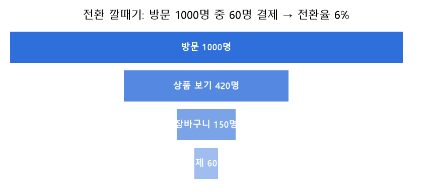
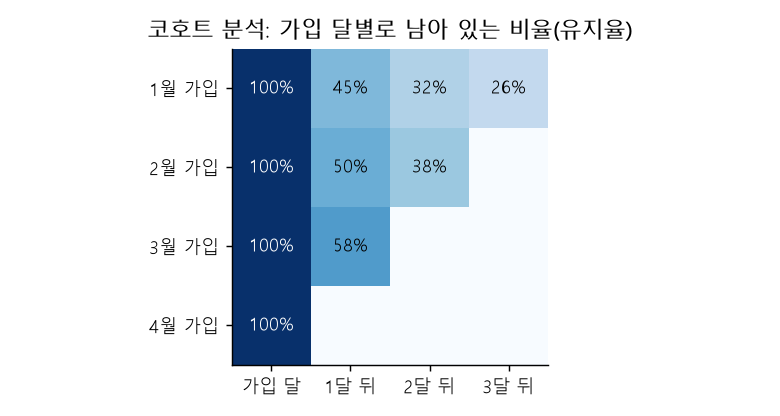
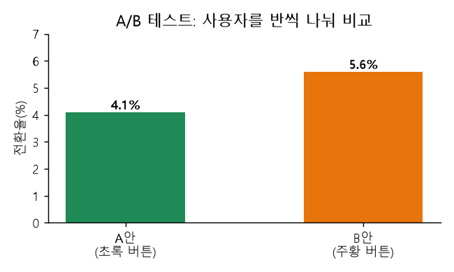

# 07 | 비즈니스·KPI 용어

@goals
- KPI 가 무엇이고 어떻게 정하는지 안다.
- 전환율·유지율·이탈률·ARPU·LTV·CAC·AOV 를 계산한다.
- 코호트 분석과 A/B 테스트로 무엇을 알 수 있는지 안다.
@end

## 07.0 | 들어가며: 숫자로 장사 실력 재기
회사에서 데이터 분석을 하는 이유는 결국 **"사업이 잘되고 있나? 무엇을 바꾸면 더 좋아질까?"** 에 답하기 위해서예요. 이 장의 용어는 쇼핑몰·앱 서비스에서 매일 쓰는 말이에요. 계산은 대부분 **나눗셈 하나**로 끝나니 겁먹지 마세요.

## 07.1 | 핵심성과지표 · KPI
@term KPI | Key Performance Indicator, 목표 달성 정도를 재는 핵심 지표

**목표를 잘 이루고 있는지** 확인하는 가장 중요한 숫자예요. 회사·팀마다 달라요. 쇼핑몰은 "월 매출, 구매 전환율", 앱은 "일 활성 사용자 수(DAU), 유지율" 같은 것이 KPI 가 돼요.

> 💡 비유: 다이어트의 KPI 는 **몸무게**, 마라톤 연습의 KPI 는 **5km 기록**. 많은 숫자 중 "이것만은 꼭 본다"는 숫자예요.

!> 좋은 KPI 는 **측정할 수 있고, 행동으로 바꿀 수 있어야** 해요. "고객 행복도 올리기"보다 "재구매율 30% → 35%"가 좋은 KPI 예요.

## 07.2 | 전환율 · Conversion Rate
@term Conversion Rate | 방문자 중 목표 행동(구매·가입 등)을 한 사람의 비율

방문한 사람 중 **우리가 원하는 행동**(구매, 회원가입, 앱 설치)을 한 사람의 비율이에요.

공식: 목표 행동 수 / 방문자 수 × 100



```python
visitors, buyers = 10000, 250
print(f"전환율 {buyers / visitors * 100:.1f}%")
```

> 💡 단계별로 사람이 줄어드는 모양을 **퍼널(깔때기)** 이라고 해요. 어느 단계에서 많이 빠지는지 보면 고칠 곳이 보여요.

## 07.3 | 유지율 · Retention Rate
@term Retention Rate | 일정 기간 뒤에도 계속 이용하는 고객의 비율

처음 온 고객 중 **일정 기간 뒤에도 다시 쓰는** 고객의 비율이에요. "1주 차 유지율 40%" = 가입한 사람 중 40% 가 1주 뒤에도 앱을 썼다는 뜻.

```python
start_users, still_active = 1000, 420
print(f"유지율 {still_active / start_users * 100:.0f}%")
```

## 07.4 | 이탈률 · Churn Rate
@term Churn Rate | 일정 기간 동안 서비스를 떠난 고객의 비율

일정 기간 동안 **떠난(해지한)** 고객의 비율이에요. 유지율의 반대예요: **이탈률 = 100% - 유지율** (같은 기간·같은 고객 기준).

```python
print(f"이탈률 {(start_users - still_active) / start_users * 100:.0f}%")
```

> 💡 구독 서비스(넷플릭스, 멜론)는 이탈률이 생명이에요. 새 고객 데려오기는 기존 고객 지키기보다 보통 훨씬 비싸거든요.

!> 웹 분석 도구의 **"이탈률(Bounce Rate)"** 은 다른 말이에요. 한 페이지만 보고 바로 나간 방문 비율이에요. 이름이 같으니 문맥을 확인하세요.

## 07.5 | 사용자당 평균 매출 · ARPU
@term ARPU | Average Revenue Per User, 사용자 한 명당 평균 매출

**전체 매출 ÷ 사용자 수**예요. 한 명이 평균 얼마를 벌어다 주는지 알려 줘요. 통신사·게임 회사가 많이 써요.

```python
revenue, users = 50_000_000, 20_000
print(f"ARPU {revenue / users:,.0f}원")
```

> 💡 비슷한 말: **ARPPU** = 돈을 낸 사용자(Paying User)만 기준으로 나눈 값이라 ARPU 보다 커요.

## 07.6 | 고객 생애 가치 · LTV / CLV
@term LTV / CLV | Life Time Value, 한 고객이 거래하는 동안 가져다주는 총 가치

한 고객이 **처음부터 떠날 때까지** 우리에게 가져다주는 돈의 합이에요. 간단한 계산법:

LTV ≈ 평균 구매 금액 × 구매 빈도 × 거래 기간

```python
aov, per_year, years = 30000, 4, 3     # 한 번에 3만 원, 1년에 4번, 3년 이용
print(f"LTV 약 {aov * per_year * years:,}원")
```

## 07.7 | 고객 획득 비용 · CAC
@term CAC | Customer Acquisition Cost, 새 고객 한 명을 데려오는 데 드는 비용

**마케팅·광고비 ÷ 새로 얻은 고객 수**예요.

```python
ad_cost, new_customers = 6_000_000, 300
cac = ad_cost / new_customers
print(f"CAC {cac:,.0f}원, LTV/CAC = {360000 / cac:.1f}")
```

> 💡 **LTV > CAC** 여야 돈을 벌어요. 보통 LTV 가 CAC 의 **3배 이상**이면 건강하다고 봐요. 고객 한 명 데려오는 데 2만 원 썼는데 평생 1만 원만 쓰고 떠나면 손해예요.

## 07.8 | 평균 주문 금액 · AOV
@term AOV | Average Order Value, 주문 한 건당 평균 금액

**총 매출 ÷ 주문 건수**예요. ARPU 는 "사람 기준", AOV 는 "주문 기준"이에요. "2만 원 이상 무료배송", "함께 사면 할인"은 AOV 를 올리려는 전략이에요.

```python
import pandas as pd
orders = pd.DataFrame({"고객": ["A", "A", "B", "C"], "금액": [20000, 30000, 15000, 35000]})
print("AOV", orders["금액"].mean())                          # 주문 기준
print("고객당 매출", orders.groupby("고객")["금액"].sum().mean())   # 사람 기준
```

## 07.9 | 코호트 분석 · Cohort Analysis
@term Cohort Analysis | 같은 시기·특징을 가진 고객 그룹을 묶어 시간에 따라 비교하는 분석

**코호트**는 같은 시기에 가입한 사람처럼 **공통점이 있는 그룹**이에요. "1월 가입자, 2월 가입자, 3월 가입자"를 따로 묶어 시간이 지나며 유지율이 어떻게 변하는지 비교해요.



> 💡 표를 읽는 법: **가로 한 줄** = 한 코호트의 시간 흐름, **세로 한 줄** = 같은 경과 기간에서 코호트끼리 비교. 3월 가입자의 1개월 차 유지율이 확 올랐다면 "3월에 바꾼 기능이 효과가 있었나?" 하고 살펴봐요.

```python
log = pd.DataFrame({
    "고객": ["a", "a", "b", "b", "c", "d", "d"],
    "가입월": ["1월", "1월", "1월", "1월", "2월", "2월", "2월"],
    "경과월": [0, 1, 0, 2, 0, 0, 1],
})
cohort = log.pivot_table(index="가입월", columns="경과월", values="고객", aggfunc="nunique")
print(cohort.div(cohort[0], axis=0).round(2))   # 0개월 차 대비 비율 = 유지율
```

## 07.10 | A/B 테스트 · A/B Test
@term A/B Test | 두 가지 버전을 무작위로 나눠 보여 주고 어느 쪽이 나은지 비교하는 실험

사용자를 **무작위로 두 그룹**으로 나눠 A 그룹엔 기존 버튼(파란색), B 그룹엔 새 버튼(빨간색)을 보여 주고, 전환율을 비교해요. 그룹만 다르고 나머지는 같으니 차이는 **버튼 때문**이라고 말할 수 있어요.



```python
from scipy.stats import chi2_contingency
#            구매  안 함
table = [[120, 2380],     # A 안: 2500명 중 120명 구매 (4.8%)
         [160, 2340]]     # B 안: 2500명 중 160명 구매 (6.4%)
chi2, p, dof, _ = chi2_contingency(table)
print(f"p-value = {p:.4f}")   # 0.05 보다 작으면 '우연이라 보기 어렵다'
```

> 💡 **p-value** 는 "실제로는 차이가 없는데 우연히 이만큼 차이 날 확률"이에요. 보통 0.05(5%) 보다 작으면 "의미 있는 차이"라고 판단해요.

!> 사람 수가 너무 적거나 기간이 너무 짧으면 결과를 믿기 어려워요. 그리고 한 번에 **한 가지만** 바꿔야 무엇 때문인지 알 수 있어요.

@quiz
? 방문자 2,000명 중 50명이 구매했다면 전환율은?
- 0.5%
+ 2.5%
- 25%
- 40%
= 50 / 2000 × 100 = 2.5%
? 유지율이 70% 라면 같은 기준의 이탈률은?
+ 30%
- 70%
- 100%
- 알 수 없다
= 이탈률 = 100% - 유지율
? 전체 매출 ÷ 주문 건수는?
- ARPU
- CAC
+ AOV
- LTV
= 주문 한 건당 평균 금액, AOV 예요.
? 건강한 사업이 되려면 LTV 와 CAC 의 관계는?
+ LTV 가 CAC 보다 충분히 커야 한다
- CAC 가 LTV 보다 커야 한다
- 둘이 같아야 한다
- 관계 없다
= 고객 한 명이 가져다주는 가치가 데려오는 비용보다 커야 해요.
? 사용자를 무작위로 나눠 두 버전을 비교하는 실험은?
- 코호트 분석
+ A/B 테스트
- 교차표
- 군집화
= A/B 테스트예요.
? 1월 가입자, 2월 가입자를 따로 묶어 유지율 변화를 비교하는 분석은?
+ 코호트 분석
- 상관분석
- 회귀분석
- 차원 축소
= 같은 시기 가입 그룹(코호트)을 비교하는 코호트 분석이에요.
@end
