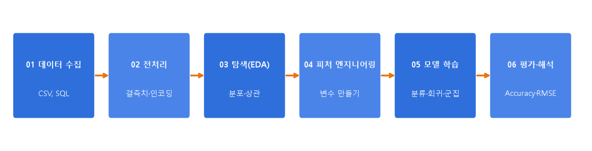

# 08 | 데이터 분석 전체 흐름

@goals
- 데이터 분석 6단계(수집 → 전처리 → EDA → 피처 엔지니어링 → 모델 학습 → 평가·해석)를 말할 수 있다.
- 앞에서 배운 용어가 어느 단계에서 쓰이는지 연결한다.
- 작은 예제로 6단계를 처음부터 끝까지 따라 해 본다.
@end

## 08.0 | 한눈에 보는 6단계

지금까지 배운 용어들은 따로 노는 게 아니라 **하나의 흐름** 안에서 차례로 등장해요.



| 단계 | 하는 일 | 이 단계의 핵심 용어 |
|---|---|---|
| 01 수집 | 데이터 모으기 | Dataset, CSV, SQL |
| 02 전처리 | 데이터 다듬기 | Missing Value, Scaling, Encoding |
| 03 EDA | 데이터 살펴보기 | Distribution, Correlation |
| 04 피처 엔지니어링 | 좋은 피처 고르기·만들기 | Feature Selection, Feature Creation |
| 05 모델 학습 | 규칙 배우기 | Classification, Regression, Clustering |
| 06 평가·해석 | 성적 매기고 의미 찾기 | Accuracy, F1-score, RMSE, R² |

> 💡 실제로는 한 번에 끝나지 않고 **왔다 갔다** 해요. 평가해 보니 점수가 낮으면 피처 엔지니어링이나 전처리로 돌아가요.

## 08.1 | 수집 · Data Collection
@term Data Collection | 분석에 필요한 데이터를 모으는 단계

파일(CSV·엑셀), 데이터베이스(SQL), 웹(API·크롤링), 설문, 센서 등에서 데이터를 가져와요.

- **CSV**(Comma-Separated Values): 쉼표로 칸을 나눈 글자 파일. 가장 흔한 데이터 형식이에요.
- **SQL**: 데이터베이스에서 원하는 데이터를 꺼내는 언어예요. (`SELECT * FROM 주문`)

```python
import pandas as pd
import io
# 실제로는 pd.read_csv("파일.csv") — 여기서는 글자를 파일처럼 읽기
csv_text = """이름,나이,구매액,재구매
김,25,30000,1
이,,45000,1
박,41,,0
최,33,52000,1
정,29,8000,0
한,52,61000,1
"""
df = pd.read_csv(io.StringIO(csv_text))
print(df)
```

## 08.2 | 전처리 단계
@term Preprocessing Step | 결측치·스케일·인코딩 등으로 데이터를 다듬는 단계

3장에서 배운 결측치 처리, 스케일링(정규화·표준화), 인코딩을 하는 단계예요.

```python
df["나이"] = df["나이"].fillna(df["나이"].median())       # 결측치 → 중앙값
df["구매액"] = df["구매액"].fillna(df["구매액"].median())
print(df.isnull().sum().sum(), "개 남은 결측치")
```

> 💡 **Scaling(스케일링)** 은 정규화·표준화를 합쳐 부르는 말이에요. 값의 크기(scale)를 맞춘다는 뜻이에요.

## 08.3 | EDA 단계
@term EDA Step | 분포와 상관관계를 보며 데이터를 이해하는 단계

4장의 분포·상관을 확인해요. "재구매한 사람은 구매액이 더 큰가?" 같은 질문을 던져요.

```python
print(df.groupby("재구매")["구매액"].mean())
print(df[["나이", "구매액", "재구매"]].corr().round(2)["재구매"])
```

## 08.4 | 피처 엔지니어링 단계 · Feature Selection / Creation
@term Feature Selection / Creation | 쓸모 있는 피처를 고르고(선택) 새로 만드는(생성) 단계

- **피처 선택(Selection)**: 예측에 도움 안 되는 열은 빼요. (이름은 재구매와 상관없으니 제외)
- **피처 생성(Creation)**: 새 열을 만들어요. (나이 → 연령대)

```python
df["연령대"] = (df["나이"] // 10 * 10).astype(int)     # 생성: 25 → 20대
X = df[["나이", "구매액"]]                              # 선택: 이름은 뺌
y = df["재구매"]
print(X.join(df["연령대"]))
```

## 08.5 | 모델 학습 단계
@term Model Training | 데이터로 모델이 규칙을 배우게 하는 단계

5장의 분류·회귀·군집화 중 문제에 맞는 것을 골라 `fit()` 으로 학습해요. 재구매 여부(0/1)는 **분류** 문제예요.

```python
from sklearn.linear_model import LogisticRegression
model = LogisticRegression().fit(X, y)      # 학습
print(model.predict([[30, 50000], [45, 9000]]))   # 새 고객 2명 예측
```

> 💡 이름에 Regression 이 들어 있지만 **LogisticRegression 은 분류 모델**이에요. "확률"을 회귀처럼 계산한 뒤 0/1 로 나누거든요. 헷갈리기 쉬운 이름이에요.

## 08.6 | 평가·해석 단계
@term Evaluation & Interpretation | 성능을 재고 결과의 의미를 설명하는 단계

6장의 지표로 성능을 재고, **"그래서 무엇을 하면 되나?"** 를 말로 설명해요. 숫자를 보고하는 것에서 끝나지 않고, 행동으로 이어지는 결론을 내는 게 분석가의 일이에요.

```python
from sklearn.metrics import accuracy_score
print("정확도", accuracy_score(y, model.predict(X)))   # 연습이라 훈련 데이터로 평가(실제로는 테스트 데이터로!)
```

> 💡 해석 예: "구매액이 클수록 재구매 확률이 높다 → 첫 구매 금액을 올리는 쿠폰(예: 5만 원 이상 10% 할인)을 시험해 보자 → A/B 테스트로 확인하자."

@quiz
? 데이터 분석 흐름의 올바른 순서는?
+ 수집 → 전처리 → EDA → 피처 엔지니어링 → 모델 학습 → 평가
- 수집 → 모델 학습 → 전처리 → 평가 → EDA
- EDA → 수집 → 평가 → 전처리
- 모델 학습 → 수집 → 평가
= 모으고, 다듬고, 살펴보고, 피처를 만들고, 배우고, 평가해요.
? 결측치 처리와 인코딩은 어느 단계인가요?
- 수집
+ 전처리
- 평가
- 모델 학습
= 데이터를 다듬는 전처리 단계예요.
? '나이'로 '연령대' 열을 새로 만드는 것은?
- 피처 선택
+ 피처 생성
- 정규화
- 평가
= 기존 열로 새 열을 만드는 피처 생성(Creation)이에요.
? F1-score, RMSE 를 보는 단계는?
- EDA
- 수집
+ 평가·해석
- 전처리
= 성능을 재는 평가 단계예요.
@end
