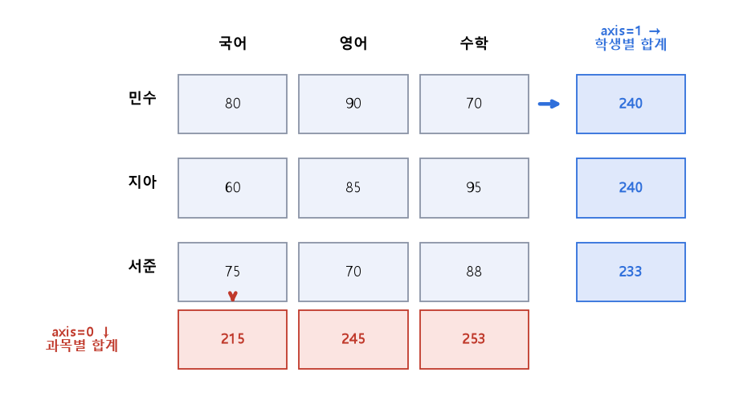

# 09 | 파이썬·pandas 용어

@goals
- 코드에 자주 나오는 영어 단어(dtype, axis, inplace, delimiter …)의 뜻을 단어 풀이로 이해한다.
- Series 와 DataFrame 의 차이를 안다.
- axis=0 과 axis=1 의 방향을 헷갈리지 않는다.
- describe, query, agg 로 데이터를 빠르게 요약한다.
@end

## 09.0 | 들어가며: 영어 단어를 알면 코드가 읽힌다

pandas 함수와 옵션 이름은 대부분 **평범한 영어 단어**예요. 단어 뜻을 알면 외우지 않아도 코드가 "읽혀요". 이 장은 단어를 **쪼개서 풀이**하는 방식으로 정리했어요.

```python
import pandas as pd
import numpy as np
# 이 장에서 같이 쓰는 성적표
df = pd.DataFrame({
    "이름": ["민수", "지아", "도윤"],
    "국어": [80, 90, 70],
    "수학": [75, 85, 95],
    "영어": [85, 70, 68],
})
print(df)
```

## 09.1 | dtype · 자료형
@term dtype | data type, 열(또는 배열)에 들어 있는 값의 자료형

**d**ata + **type** = 데이터의 **종류**예요. 숫자인지(int64, float64), 글자인지(object/str), 참거짓인지(bool), 날짜인지(datetime64) 알려 줘요.

```python
print(df.dtypes)
print(df["국어"].astype(float).dtype)     # 자료형 바꾸기: 정수 → 실수
```

> 💡 int**64** 의 64 는 숫자 하나를 저장하는 데 쓰는 칸(비트) 수예요. 숫자가 클수록 더 큰 수를 담을 수 있어요.

## 09.2 | Series · 시리즈
@term Series | 값과 인덱스로 이루어진 1차원 데이터 (엑셀의 한 열)

**한 줄로 늘어선 값들**에 **이름표(인덱스)** 가 붙은 1차원 데이터예요. 엑셀의 **한 열**과 같아요. 영어 series 는 "연속, 줄지어 있는 것"이라는 뜻이에요(드라마 시리즈처럼).

```python
s = pd.Series([10, 20, 30], index=["a", "b", "c"])
print(s)
print(s["b"])               # 이름표로 값 꺼내기
```

> 💡 이름표(key)로 값(value)을 찾는다는 점에서 파이썬 딕셔너리, JSON 의 key-value 와 비슷해요.

## 09.3 | DataFrame · 데이터프레임
@term DataFrame | 행과 열로 이루어진 2차원 표 (Series 여러 개를 옆으로 붙인 것)

**행과 열이 있는 표**예요. 열 하나를 꺼내면 Series 가 돼요. data(데이터) + frame(틀) = "데이터를 담는 틀".

```python
print(type(df))              # DataFrame
print(type(df["국어"]))       # 열 하나 = Series
print(df.shape)              # (행 수, 열 수)
```

## 09.4 | axis · 축
@term axis | 계산 방향 (0 = 행 방향 ↓ 위에서 아래로, 1 = 열 방향 → 옆으로)

axis 는 **"어느 방향으로 계산하나"** 예요. 가장 헷갈리는 옵션이니 그림으로 기억해요.

- **axis=0** (기본값): **↓ 위에서 아래로** 훑어요 → 결과가 **열마다** 하나 (과목별 합계)
- **axis=1**: **→ 옆으로** 훑어요 → 결과가 **행마다** 하나 (학생별 합계)



```python
score = df.set_index("이름")
print(score.sum(axis=0))     # ↓ 과목별 합계
print(score.sum(axis=1))     # → 학생별 합계
```

> 💡 기억법: **0 은 세로로 선 막대(|)**, **1 은 옆으로 누운 막대(—)** 를 떠올려 보세요. 또는 "axis=1 → 열(column) 이름을 따라 옆으로". `df.drop("국어", axis=1)` 이 열을 지우는 것도 같은 이치예요.

## 09.5 | inplace · 제자리에서
@term inplace | True 면 원본을 직접 바꿈, False(기본)면 바뀐 복사본을 돌려줌

in + place = **"그 자리에서"** 라는 뜻이에요.

- `inplace=False` (기본값): 원본은 그대로, **바뀐 새 표를 돌려줘요.** → 변수에 다시 담아야 해요.
- `inplace=True`: **원본 자체를 바꾸고** 아무것도 돌려주지 않아요(None).

```python
t = df.copy()
t2 = t.drop(columns="영어")              # 기본: 복사본을 돌려줌
print(t.columns.tolist(), t2.columns.tolist())
t.drop(columns="영어", inplace=True)      # 원본을 바꿈
print(t.columns.tolist())
```

!> `df = df.drop(..., inplace=True)` 처럼 쓰면 df 가 **None** 이 돼 버려요! 요즘은 inplace 대신 `df = df.drop(...)` 처럼 **다시 담는 방식**을 더 권해요.

## 09.6 | delimiter · 구분자
@term delimiter | 파일에서 칸(값)과 칸을 나누는 기호

de + limit(경계) = **경계를 정해 주는 것**이에요. 글자 파일에서 칸을 나누는 기호예요. pandas 에서는 `sep` 이라는 이름도 같이 써요.

| 파일 | 구분자 | 예 |
|---|---|---|
| CSV | `,` 쉼표 | 민수,80,75 |
| TSV | `\t` 탭 | 민수(탭)80(탭)75 |
| 기타 | `;` `|` | 민수;80;75 |

```python
import io
text = "이름;점수\n민수;80\n지아;90"
print(pd.read_csv(io.StringIO(text), delimiter=";"))   # sep=";" 와 같음
```

## 09.7 | describe · 요약 통계
@term describe | 개수·평균·표준편차·최솟값·사분위수·최댓값을 한 번에 보여 주는 함수

describe = **묘사하다, 설명하다.** 데이터를 한 줄로 "설명해 줘" 하면 요약 통계표가 나와요. 처음 데이터를 받으면 가장 먼저 해 보는 함수예요.

```python
print(df.describe().round(1))             # 수치형 열 요약
print(df.describe(include="object"))      # 글자 열 요약: 개수, 고유값 수, 최빈값(top), 그 빈도(freq)
```

> 💡 pandas 3 부터는 글자 열 자료형이 `str` 로 바뀌어서 `include="str"` 로 써도 돼요. 둘 다 동작하게 하려면 `include=["object", "string"]` 처럼 쓸 수도 있어요.

## 09.8 | numeric · numeric_only
@term numeric_only | True 면 숫자 열만 골라 계산

numeric = **숫자의.** `numeric_only=True` 는 "**숫자 열만** 계산해 줘"라는 뜻이에요. 글자 열이 섞인 표에서 평균을 구하면 오류가 나는데, 이 옵션으로 글자 열을 건너뛰어요.

```python
print(df.mean(numeric_only=True))         # '이름' 열은 건너뜀
```

## 09.9 | query · 질의
@term query | 조건을 글자(문장)로 써서 행을 골라내는 함수

query = **질문, 질의.** 표에 "이런 조건인 행 보여 줘" 하고 묻는 거예요. 대괄호 조건보다 읽기 쉬워요.

```python
print(df.query("수학 >= 80 and 국어 >= 80"))
print(df[(df["수학"] >= 80) & (df["국어"] >= 80)])   # 같은 결과 (대괄호 방식)
```

## 09.10 | aggregation · agg
@term agg | 여러 집계 함수(mean, sum, count, max, min)를 한 번에 적용

aggregate = **모으다, 합치다.** 여러 값을 모아 하나로 요약해요(3장 집계). `agg()` 에 함수 이름을 목록으로 주면 한 번에 여러 요약을 볼 수 있어요.

```python
print(df[["국어", "수학"]].agg(["mean", "sum", "count", "max", "min"]))
```

## 09.11 | statistic · 통계치
@term statistic | 데이터에서 계산한 하나의 요약 숫자 (평균, 검정 통계량 등)

statistic(단수) = 데이터로 계산한 **숫자 하나**(평균, 표준편차, t 값 …). statistic**s**(복수) = **통계학**이라는 학문. 검정 함수 결과에 `statistic` 과 `pvalue` 가 같이 나오는 경우가 많아요.

```python
from scipy import stats
r = stats.ttest_ind([80, 90, 70], [75, 85, 95])   # 국어 vs 수학 평균 차이 검정
print(round(r.statistic, 3), round(r.pvalue, 3))
```

## 09.12 | matplotlib · 맷플롯립
@term matplotlib | 파이썬의 대표 그래프(시각화) 라이브러리

**Mat** + **Plot** + **Lib** = MATLAB(공학 계산 프로그램) 스타일로 **그래프를 그리는 라이브러리**예요. 보통 `import matplotlib.pyplot as plt` 로 불러요.

```python
import matplotlib
matplotlib.use("Agg")
import matplotlib.pyplot as plt
plt.figure(figsize=(4, 3))
plt.bar(["KOR", "MATH", "ENG"], df[["국어", "수학", "영어"]].mean())
plt.title("average")
plt.show()
print("막대그래프 완성")
```

> 💡 앱에서 실행하면 그래프가 결과 창에 그림으로 보여요. 그래프 안 글자는 한글 글꼴이 없을 수 있어 영어로 썼어요.

## 09.13 | scatter · 산점도
@term scatter | 흩뿌리다 — 점을 흩뿌린 듯 찍는 산점도 함수

scatter = **흩뿌리다.** 씨앗을 뿌리듯 점을 흩뿌린 그래프라서 산점도(散點圖, 흩을 산·점 점)예요. `plt.scatter(x, y)` 로 그려요(4장 산점도).

```python
plt.figure(figsize=(4, 3))
plt.scatter(df["국어"], df["수학"])
plt.xlabel("KOR"); plt.ylabel("MATH")
plt.show()
print("산점도 완성")
```

## 09.14 | prompt · 프롬프트
@term prompt | AI 에게 하는 요청(지시문)

prompt = **재촉하다, 일깨우다.** ChatGPT·Claude 같은 AI 에게 **입력하는 요청문**이에요. 데이터 분석에서도 AI 에 코드 작성·해석을 부탁할 때 프롬프트를 잘 쓰면 결과가 훨씬 좋아져요.

좋은 프롬프트의 예:

```text
pandas DataFrame df 에 '날짜', '매출' 열이 있어.
월별 매출 합계를 구하고 꺾은선 그래프로 그려 줘.
코드마다 한국어 주석을 달아 줘.
```

> 💡 팁: **무엇을 가지고(데이터), 무엇을, 어떤 형태로** 원하는지 구체적으로 적어요. AI 가 만든 코드는 꼭 직접 실행해서 결과를 확인해요.

@quiz
? df.sum(axis=1) 의 결과는?
- 열(과목)마다 합계
+ 행(학생)마다 합계
- 전체 합계 하나
- 오류
= axis=1 은 옆으로(→) 더해서 행마다 결과가 하나씩 나와요.
? inplace=True 의 뜻은?
+ 원본을 직접 바꾼다
- 복사본을 돌려준다
- 결측치를 채운다
- 숫자 열만 계산한다
= in place = 그 자리에서. 원본을 바꾸고 None 을 돌려줘요.
? TSV 파일의 구분자는?
- 쉼표 ,
+ 탭 \t
- 세미콜론 ;
- 공백 두 칸
= Tab-Separated Values, 탭으로 칸을 나눠요.
? 엑셀의 한 열처럼 값과 인덱스로 된 1차원 데이터는?
+ Series
- DataFrame
- dtype
- axis
= Series 예요. 여러 개를 옆으로 붙이면 DataFrame 이 돼요.
? 글자 열이 섞인 표에서 숫자 열만 평균 내는 옵션은?
- inplace=True
- axis=1
+ numeric_only=True
- include='object'
= numeric_only=True 는 숫자 열만 계산해요.
? df.query("수학 >= 80") 은 무엇을 하나요?
- 수학 열을 지운다
+ 수학이 80 이상인 행만 고른다
- 수학 평균을 구한다
- 수학 열을 정렬한다
= query 는 조건에 맞는 행을 골라내요.
@end
