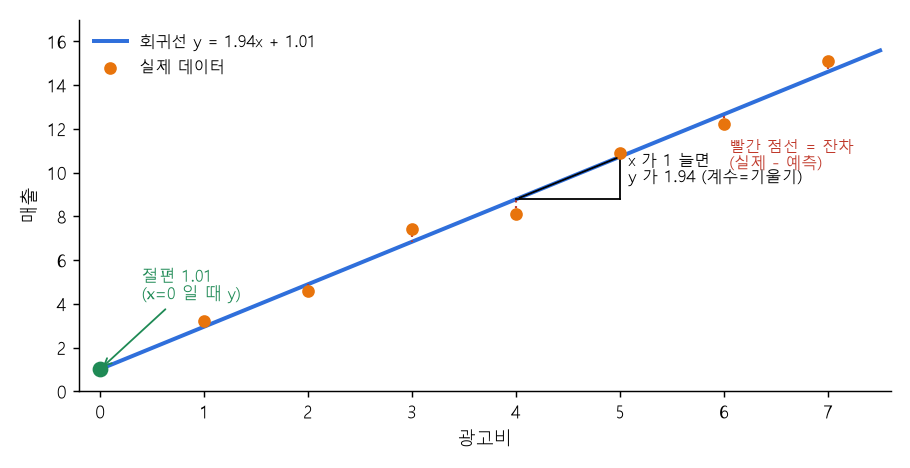
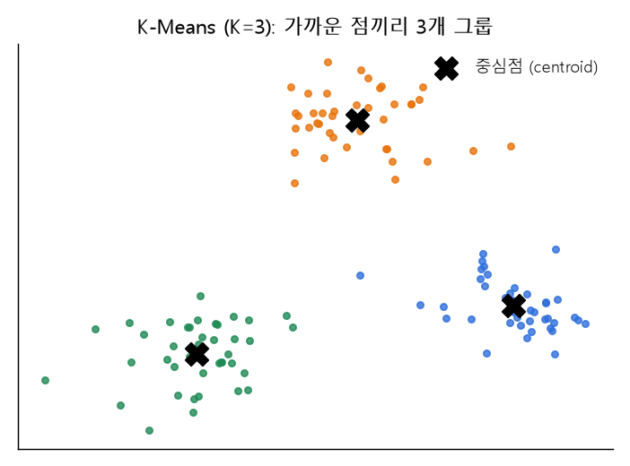
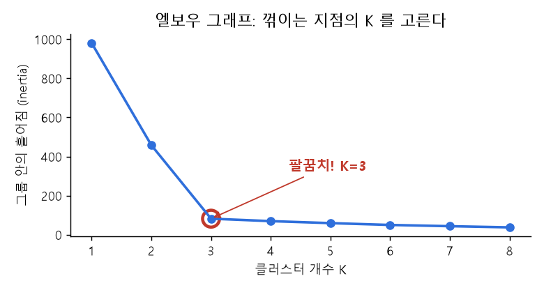
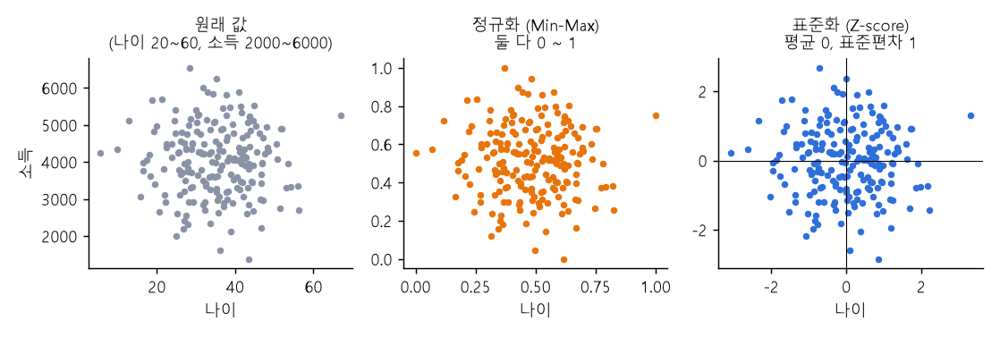

# 10 | 통계 모델·분석 분야 용어

@goals
- Regression(회귀)이라는 이름의 유래와 뜻을 안다.
- 절편(Intercept)과 계수(Coefficient)를 회귀식에서 찾는다.
- statsmodels 의 OLS 결과와 Shapiro-Wilk 정규성 검정을 읽는다.
- KMeans 와 엘보 방법으로 군집 수를 정한다.
- 패널 데이터·금융 데이터·계량 분석이 무엇인지 안다.
@end

## 10.1 | Regression · 회귀
@term Regression | 원래 뜻 '되돌아감' — 과거 데이터로 숫자 값을 짐작하는 방법

re(다시) + gress(가다) = **"되돌아가다"** 라는 뜻이에요. 그런데 왜 예측 방법에 이런 이름이 붙었을까요?

19세기 영국의 과학자 **골턴(Galton)** 은 부모와 자식의 키를 조사했어요. 그랬더니 아주 키 큰 부모의 자식은 부모보다 **조금 덜 크고**, 아주 작은 부모의 자식은 부모보다 **조금 더 커서**, 자식 키가 **평균 쪽으로 되돌아가는** 경향이 있었어요. 이것을 "평균으로의 회귀(regression toward the mean)"라고 불렀고, 이때 쓴 직선 맞추기 방법이 그대로 **회귀 분석**이라는 이름이 됐어요.

> 💡 지금은 "회귀 = **과거 데이터의 관계를 이용해 숫자 값을 짐작**하는 방법" 으로 이해하면 충분해요. 예: 달걀(알) 무게로 병아리 무게를 짐작, 공부시간으로 점수를 짐작.



## 10.2 | LinearRegression · 선형 회귀
@term LinearRegression | 직선(y = ax + b)으로 관계를 나타내는 회귀 모델

Linear = **직선의.** 데이터에 가장 잘 맞는 **직선 y = ax + b** 를 찾아요. sklearn 의 `LinearRegression` 으로 만들어요.

```python
from sklearn.linear_model import LinearRegression
import numpy as np

egg = np.array([[50], [55], [60], [65], [70]])   # 알 무게(g)
chick = np.array([33, 37, 40, 44, 47])            # 병아리 무게(g)
model = LinearRegression().fit(egg, chick)
print("기울기(계수) a =", model.coef_.round(3))
print("절편 b =", round(model.intercept_, 3))
print("알 62g → 병아리 약", model.predict([[62]]).round(1), "g")
```

## 10.3 | Intercept · 절편
@term Intercept | x 가 0 일 때의 y 값, 직선이 y축과 만나는 점 (y = ax + b 의 b)

intercept = **가로채다, 길목에서 잡다.** 직선이 **y축을 가로지르며 만나는 지점**이에요. y = ax + **b** 의 **b** 예요. 그래프의 "시작점(출발점)" 으로 생각하면 쉬워요.

> 💡 절편이 늘 현실적인 뜻을 갖는 건 아니에요. 위 예에서 절편은 "알 무게 0g 일 때 병아리 무게"라서 실제로는 의미가 없어요. 직선을 제자리에 놓기 위한 값이라고 보면 돼요.

## 10.4 | Coefficient · 계수
@term Coefficient | 변수 앞에 곱해지는 수 (기울기, 영향력)

co(함께) + efficient(작용하는) = **변수와 함께 작용하는 수**예요. y = **a**x + b 의 **a**, 즉 **기울기**예요. "x 가 1 늘면 y 가 a 만큼 늘어난다"로 읽어요.

변수가 여러 개인 **다중 회귀**(y = a₁x₁ + a₂x₂ + b)에서는 계수가 각 변수의 **영향력**을 나타내요.

```python
import pandas as pd
d = pd.DataFrame({"공부": [1, 2, 3, 4, 5, 6], "수면": [8, 7, 7, 6, 6, 5], "점수": [55, 61, 68, 72, 78, 83]})
m = LinearRegression().fit(d[["공부", "수면"]], d["점수"])
print(dict(zip(["공부", "수면"], m.coef_.round(2))), round(m.intercept_, 2))
```

!> 단위가 다르면 계수 크기를 그대로 비교하면 안 돼요(시간 vs 원). 영향력을 비교하려면 **표준화한 뒤** 회귀해요.

## 10.5 | statsmodels · 통계 모델 라이브러리
@term statsmodels | stats + models, 통계 모델과 검정을 자세한 표로 보여 주는 라이브러리

**stats**(통계) + **models**(모델). sklearn 이 "예측을 잘하는 것"에 집중한다면, statsmodels 는 **"결과를 통계적으로 설명하는 것"** 에 강해요. 계수마다 p-value, 신뢰구간, R² 를 표로 보여 줘요. 경제·사회과학 연구에서 많이 써요.

## 10.6 | OLS · 최소제곱법
@term OLS | Ordinary Least Squares, 잔차 제곱합이 가장 작은 직선을 찾는 방법

**O**rdinary(보통의) **L**east(가장 작은) **S**quares(제곱) = **"오차 제곱의 합이 가장 작은"** 직선을 찾는 방법이에요. **잔차(residual)** 는 실제 값과 직선의 차이(그림의 세로 점선)예요. 이걸 제곱해서 다 더한 값이 가장 작아지는 직선을 골라요. LinearRegression 도 내부에서 이 방법을 써요.

```python
import statsmodels.api as sm
X = sm.add_constant(d[["공부", "수면"]])     # 절편(const) 열 추가
res = sm.OLS(d["점수"], X).fit()
print(res.params.round(2))                  # 절편과 계수
print("R² =", round(res.rsquared, 3))
print(res.pvalues.round(3))                 # 계수마다 p-value
```

> 💡 `res.summary()` 를 출력하면 큰 결과표가 나와요. 처음에는 **coef(계수), P>|t|(p-value), R-squared** 세 가지만 보면 돼요.

## 10.7 | Shapiro-Wilk · 정규성 검정
@term Shapiro-Wilk | 데이터가 정규분포를 따르는지 확인하는 검정

**샤피로(Shapiro)** 와 **윌크(Wilk)** 두 통계학자가 만든 검정이에요. "이 데이터는 정규분포다"를 가정하고 확인해요.

- p-value **≥ 0.05**: 정규분포라고 봐도 괜찮다
- p-value **< 0.05**: 정규분포가 아닐 가능성이 크다

```python
from scipy.stats import shapiro
rng = np.random.default_rng(3)
normal = rng.normal(170, 6, 50)        # 정규분포 키 데이터
skewed = rng.exponential(1, 50)        # 한쪽으로 치우친 데이터
print("정규:", round(shapiro(normal).pvalue, 3))
print("치우침:", f"{shapiro(skewed).pvalue:.1e}")   # 아주 작은 수 (e-05 = 0.00001 배)
```

> 💡 t-검정, 선형 회귀 같은 많은 방법이 "정규분포"를 가정해서, 쓰기 전에 확인하는 거예요. 데이터가 아주 많으면(수천 개) 작은 차이도 잡아내니 히스토그램도 함께 봐요.

## 10.8 | KMeans · K-평균 군집화
@term KMeans | K 개의 중심점(평균)을 기준으로 데이터를 K 개 그룹으로 나누는 방법

**K** = 나눌 **그룹 수**, **Means** = 각 그룹의 **중심점(평균)**. 중심점을 **센트로이드(centroid)** 라고 불러요.

1. 중심점 K 개를 아무 데나 놓는다
2. 각 점을 **가장 가까운 중심점** 그룹에 넣는다
3. 그룹마다 **평균 위치**로 중심점을 옮긴다
4. 더 이상 안 움직일 때까지 2~3 반복



```python
from sklearn.cluster import KMeans
pts = np.array([[1, 2], [1, 4], [2, 3], [8, 8], [9, 9], [8, 10], [15, 2], [16, 1], [15, 3]])
km = KMeans(n_clusters=3, n_init=10, random_state=0).fit(pts)
print(km.labels_)                       # 점마다 그룹 번호
print(km.cluster_centers_.round(1))     # 센트로이드
```

> 💡 거리로 묶으니까 피처 단위가 다르면 꼭 **정규화·표준화**를 먼저 해요(3장).

## 10.9 | Elbow · 엘보 방법
@term Elbow | 팔꿈치처럼 꺾이는 지점으로 적당한 군집 수 K 를 고르는 방법

K 를 1, 2, 3 … 으로 늘리며 **그룹 안의 퍼짐(inertia, 점과 중심점 거리 제곱합)** 을 그래프로 그려요. K 가 커질수록 계속 줄어드는데, **팔꿈치(elbow)처럼 확 꺾이는 지점**부터는 줄어드는 폭이 작아요. 그 지점이 적당한 K 예요.



```python
for k in range(1, 6):
    print(k, round(KMeans(n_clusters=k, n_init=10, random_state=0).fit(pts).inertia_, 1))
```

- K 가 **너무 작으면**: 서로 다른 무리가 한 그룹에 섞여요.
- K 가 **너무 크면**: 같은 무리가 쓸데없이 쪼개져요(극단적으로 점 하나에 그룹 하나).

## 10.10 | 패널 데이터 · Panel Data
@term Panel Data | 여러 개체를 여러 시점에 걸쳐 반복 관찰한 데이터 (횡단면 + 시계열)

**여러 대상**(사람·회사·나라)을 **여러 시점**에 걸쳐 **반복해서** 관찰한 데이터예요.

- **횡단면 데이터**: 한 시점에 여러 대상 (2026년 회사 100곳 매출)
- **시계열 데이터**: 한 대상의 여러 시점 (삼성 10년치 매출)
- **패널 데이터**: 둘을 합친 것 (회사 100곳 × 10년치 매출)

```python
panel = pd.DataFrame({
    "회사": ["A", "A", "B", "B"],
    "연도": [2025, 2026, 2025, 2026],
    "매출": [100, 120, 80, 90],
}).set_index(["회사", "연도"])          # 대상 + 시점, 두 단계 인덱스
print(panel)
print(panel.groupby(level="회사").pct_change().round(2))   # 회사별 전년 대비 증가율
```

> 💡 비유: 같은 학생들의 성적을 **매 학기 계속 기록한** 성적부예요.

## 10.11 | 금융 데이터 · Financial Data
@term Financial Data | 주가·환율·금리·재무제표 등 돈과 관련된 데이터

**주가, 환율, 금리, 재무제표**(매출·이익·부채) 같은 돈과 관련된 데이터예요. 대부분 **시간 순서**가 중요한 시계열이라 날짜 처리와 **수익률**(전날 대비 변화율) 계산을 많이 해요.

```python
price = pd.Series([10000, 10200, 9900, 10500], index=pd.date_range("2026-11-02", periods=4))
print(price.pct_change().round(4))      # 일간 수익률
print(price.rolling(2).mean())          # 2일 이동평균
```

## 10.12 | 계량 분석 · Econometrics
@term Econometrics | 경제 이론을 데이터와 통계로 검증하는 분석

**계량**(計量, 셀 계·헤아릴 량) = 숫자로 **헤아려 잰다.** 경제학의 이론("금리가 오르면 소비가 줄어든다")이 실제 데이터에서도 맞는지 **통계로 검증**하는 분야예요. 계량경제학이라고도 해요. OLS 회귀, 패널 데이터 분석이 대표 도구예요.

## 10.13 | 정리: 표준화 vs 정규화
@term 표준화 vs 정규화 | 표준화 = 평균 기준 위치 맞추기, 정규화 = 0~1 범위 크기 맞추기

헷갈리는 두 용어를 한 줄로 정리해요.

- **표준화**(Standardization): **평균을 기준으로 위치를 맞추기** → 평균 0, 표준편차 1
- **정규화**(Normalization): **범위를 0~1 로 크기 맞추기** → 최솟값 0, 최댓값 1



```python
from sklearn.preprocessing import StandardScaler, MinMaxScaler
x = np.array([[20], [30], [40], [60]])
print("표준화:", StandardScaler().fit_transform(x).ravel().round(2))
print("정규화:", MinMaxScaler().fit_transform(x).ravel().round(2))
```

!> "정규화"는 분야에 따라 다른 뜻으로도 써요(데이터베이스 정규화, 모델 규제 regularization). 데이터 전처리에서는 보통 Min-Max 를 말해요.

@quiz
? Regression(회귀)이라는 이름이 생긴 계기는?
- 그래프가 원을 그리며 돌아서
+ 자식의 키가 평균 쪽으로 되돌아가는 현상을 연구해서
- 컴퓨터가 처음으로 돌아가서 다시 계산해서
- 시간을 거꾸로 계산해서
= 골턴의 '평균으로의 회귀' 연구에서 이름이 왔어요.
? y = 3x + 5 에서 절편은?
- 3
+ 5
- x
- 8
= y = ax + b 에서 b 가 절편이에요.
? y = 3x + 5 에서 x 가 1 늘면 y 는?
+ 3 늘어난다
- 5 늘어난다
- 8 늘어난다
- 변하지 않는다
= 계수(기울기) 3 만큼 늘어나요.
? OLS 는 무엇을 가장 작게 만드나요?
- 절편
- 데이터 개수
+ 잔차 제곱의 합
- 상관계수
= Ordinary Least Squares, 잔차 제곱합을 최소로 해요.
? Shapiro-Wilk 검정 p-value 가 0.001 이라면?
- 정규분포라고 봐도 된다
+ 정규분포가 아닐 가능성이 크다
- 데이터가 없다
- 군집이 3개다
= p < 0.05 이면 정규분포 가정을 받아들이기 어려워요.
? KMeans 의 K 는?
+ 나눌 그룹(군집) 수
- 반복 횟수
- 데이터 개수
- 피처 개수
= K 는 그룹 수, Means 는 그룹의 중심점(평균)이에요.
? 회사 100곳의 매출을 10년간 기록한 데이터는?
- 횡단면 데이터
- 시계열 데이터
+ 패널 데이터
- 범주형 데이터
= 여러 대상 × 여러 시점, 패널 데이터예요.
@end
