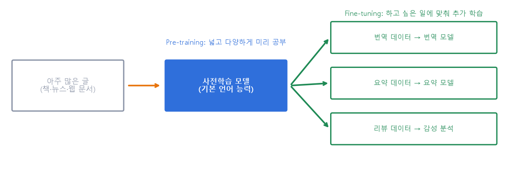
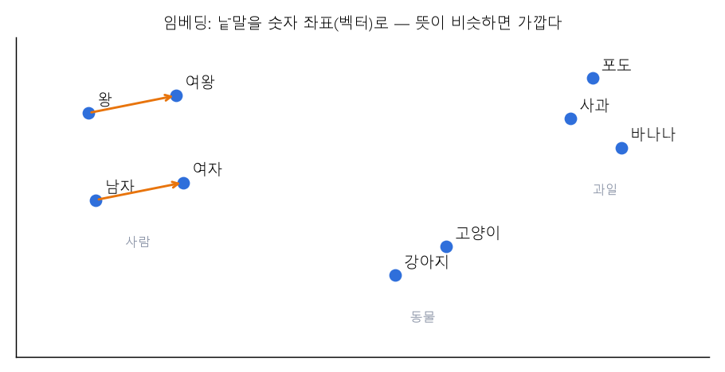
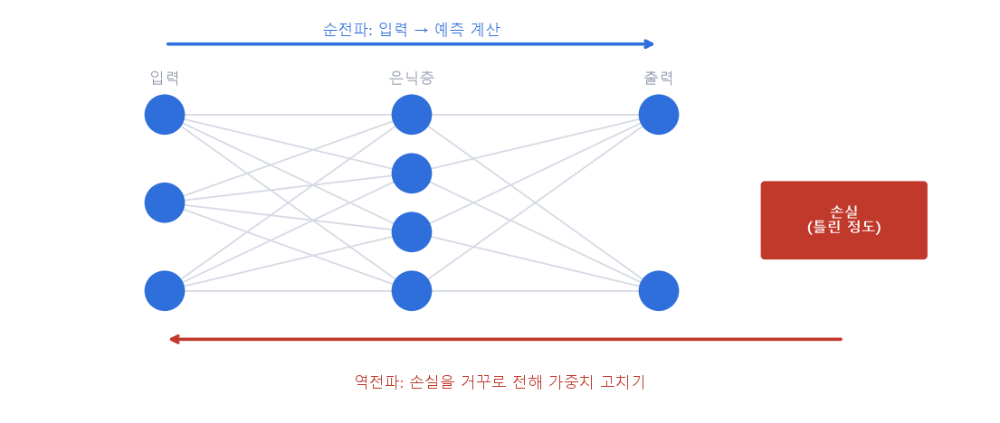
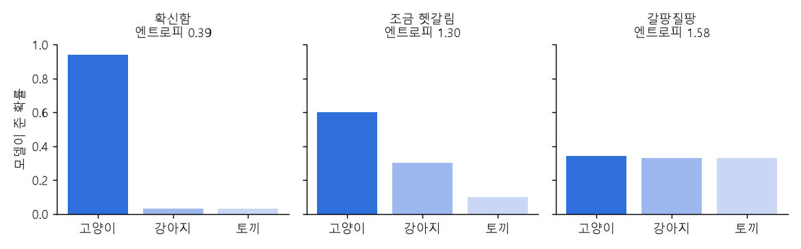
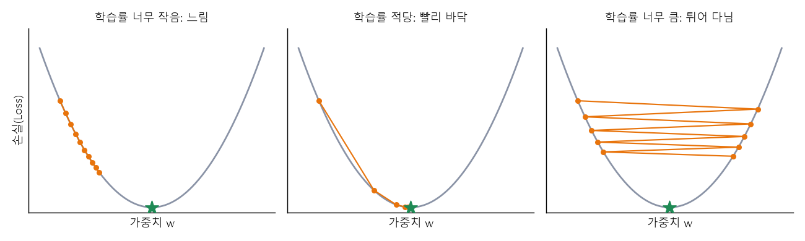
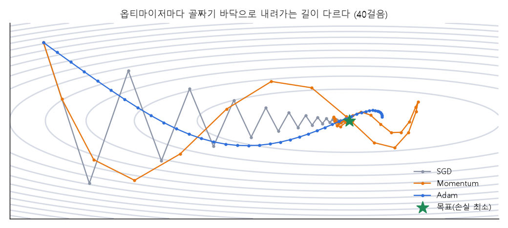
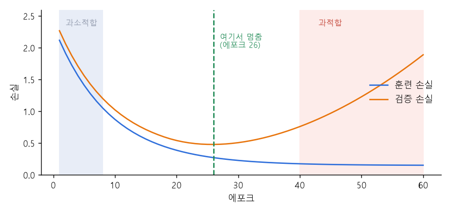
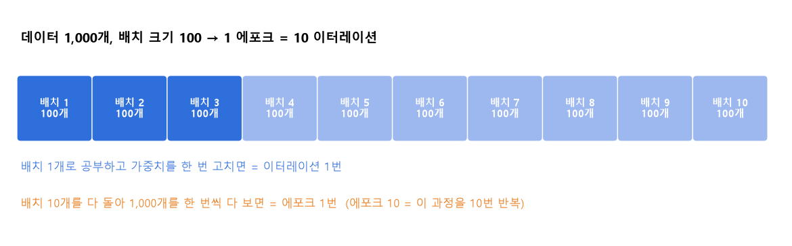

# 11 | 인공지능(딥러닝) 학습 용어

@goals
- 사전학습(Pre-training)과 미세조정(Fine-tuning)의 차이를 말할 수 있다.
- 토큰화·임베딩으로 AI 가 글을 숫자로 바꾸는 과정을 안다.
- 손실 함수·기울기·학습률·옵티마이저로 '학습'이 어떻게 일어나는지 그림으로 이해한다.
- 에포크·배치 크기·이터레이션을 계산할 수 있다.
- 분류기·감성 분석, Pydantic·SpooledTemporaryFile 같은 AI 서비스 용어를 안다.
@end

## 11.0 | 들어가며: AI 는 어떻게 공부할까?

딥러닝(신경망) 모델의 공부는 **"예측해 보기 → 얼마나 틀렸는지 재기 → 덜 틀리게 고치기"** 의 반복이에요. 이 장의 용어들은 모두 이 반복의 어느 부분을 부르는 이름이에요.

| 단계 | 하는 일 | 관련 용어 |
|---|---|---|
| 글 준비 | 글을 조각내고 숫자로 바꾸기 | 토큰화, sentencepiece, 임베딩 |
| 예측 | 입력에서 출력까지 계산 | 순전파(Propagation) |
| 채점 | 얼마나 틀렸나 재기 | 손실 함수, 엔트로피 |
| 고치기 | 덜 틀리게 가중치 조절 | 역전파, 기울기, 학습률, 최적화, 옵티마이저 |
| 반복 | 몇 번, 몇 개씩 공부할지 | 에포크, 배치 크기, 이터레이션 |

## 11.1 | 사전학습 · Pre-training
@term Pre-training | AI 가 기본 언어 능력을 갖추도록 넓고 다양한 글로 미리 공부하는 것

책·뉴스·웹 문서처럼 **아주 많고 다양한 글**로 먼저 공부시켜 **기본 언어 능력**(낱말 뜻, 문법, 상식)을 갖추게 하는 단계예요. 보통 "다음에 올 낱말 맞히기"를 수십억 번 반복해요. 이렇게 만든 모델을 **사전학습 모델(기반 모델, foundation model)** 이라 하고, ChatGPT·Claude 같은 대형 언어 모델(LLM)도 이 단계를 거쳐요.



> 💡 비유: 초·중·고에서 **국어·수학·과학을 두루** 배우는 것. 어떤 직업을 갖든 바탕이 돼요.

## 11.2 | 미세조정 · Fine-tuning
@term Fine-tuning | 사전학습 모델을 원하는 작업(번역·요약 등)에 맞춰 추가 학습하는 것

사전학습 모델에 **진짜 하고 싶은 일의 데이터**(번역 문장 쌍, 리뷰와 감정 등)를 조금 더 보여 줘서 **맞춤형으로 추가 학습**시키는 거예요. fine = 섬세한, tuning = 조율 → "악기 줄을 미세하게 맞추듯" 다듬는다는 뜻이에요.

> 💡 비유: 고등학교까지 마친 사람이 **간호학과**에 들어가 전문 지식을 배우는 것.

### 사전학습 + 미세조정의 장점

- **더 빠르게**: 처음부터 가르치지 않으니 데이터와 시간이 훨씬 적게 들어요.
- **더 똑똑하게**: 이미 언어를 아는 상태라 적은 데이터로도 성능이 좋아요.
- 이렇게 이미 배운 지식을 다른 일에 옮겨 쓰는 것을 **전이 학습(Transfer Learning)** 이라 해요.

## 11.3 | 토큰 · 토큰화 · Token / Tokenization
@term Token | AI 모델이 글을 처리하는 가장 작은 단위(조각)

AI 는 글을 통째로 읽지 못하고 **토큰(조각)** 단위로 잘라서 처리해요. 이렇게 자르는 일을 **토큰화(tokenization)**, 자르는 도구를 **토크나이저(tokenizer)** 라고 해요. 토큰은 낱말일 수도, 낱말보다 작은 조각일 수도 있어요.

- 대략 영어는 **4글자 ≒ 1토큰**, 한글은 **1~2글자 ≒ 1토큰** 정도예요 (모델마다 달라요).
- AI 사용 요금, 한 번에 넣을 수 있는 글의 양(컨텍스트 윈도우, 12장)이 모두 **토큰 수**로 정해져요.

```python
# 가장 단순한 토큰화: 띄어쓰기로 자르기 (실제 AI 는 더 작은 조각으로 자른다)
text = "데이터 분석은 재미있다"
tokens = text.split()
print(tokens, len(tokens), "개")
vocab = {w: i for i, w in enumerate(sorted(set(tokens)))}   # 조각마다 번호 붙이기
print([vocab[t] for t in tokens])                            # AI 에는 이 번호가 들어간다
```

## 11.4 | sentencepiece · 센텐스피스
@term sentencepiece | 문장을 낱말보다 작은 조각(subword)으로 쪼개는 토크나이저 도구

구글이 만든 **토크나이저 도구**예요. sentence(문장) + piece(조각) = 문장을 조각으로. 문장을 **낱말보다 더 작은 단위(subword)** 로 나눠서 AI 가 처리하기 쉽게 만들어 줘요. 띄어쓰기 자리는 `▁` 기호로 표시해요.


왜 더 작게 자를까?

- "데이터분석은", "데이터분석을", "데이터분석이"를 모두 따로 외우면 낱말 사전이 끝없이 커져요.
- `데이터` + `분석` + `은` 으로 나누면 **적은 조각으로 많은 낱말**을 표현하고, 처음 보는 낱말도 아는 조각으로 나눠 처리할 수 있어요.

```python norun
# 실제 사용 예 (pip install sentencepiece, 학습용 글 파일 필요 — 이 교안·앱에서는 실행하지 않아요)
import sentencepiece as spm
spm.SentencePieceTrainer.train(input="corpus.txt", model_prefix="ko", vocab_size=8000)   # 조각 사전 만들기
sp = spm.SentencePieceProcessor(model_file="ko.model")
print(sp.encode("데이터분석은 재미있다", out_type=str))   # 예: ['▁데이터', '분석', '은', '▁재미', '있다']
```

## 11.5 | 임베딩 · Embedding
@term Embedding | 글·이미지·소리 등을 의미가 담긴 숫자 벡터로 바꾸는 것

토큰 번호만으로는 뜻을 알 수 없어요. 그래서 각 토큰을 **숫자 여러 개로 된 좌표(벡터)** 로 바꾸는데, **뜻이 비슷하면 가까운 곳**에 놓이도록 학습해요. 이것이 임베딩이에요. 문장·이미지·오디오도 임베딩할 수 있어요.



```python
import numpy as np
# 아주 작은 가짜 임베딩 (실제는 수백~수천 개의 숫자)
emb = {"강아지": np.array([0.9, 0.8, 0.1]), "고양이": np.array([0.85, 0.75, 0.2]), "자동차": np.array([0.1, 0.2, 0.95])}
def cos(a, b):                                      # 코사인 유사도: 방향이 비슷할수록 1 에 가까움
    return round(float(a @ b / (np.linalg.norm(a) * np.linalg.norm(b))), 3)
print("강아지-고양이", cos(emb["강아지"], emb["고양이"]))
print("강아지-자동차", cos(emb["강아지"], emb["자동차"]))
```

> 💡 검색, 추천, RAG(12장)에서 "뜻이 비슷한 글 찾기"는 모두 임베딩 사이의 거리로 해요.

## 11.6 | 순전파 · 역전파 · Propagation
@term Propagation | 전파 — 신경망에서 값(순전파)이나 오차(역전파)가 층을 따라 전해지는 것

propagation = **전파, 퍼져 나감.** 신경망에서는 두 방향이 있어요.

- **순전파(Forward Propagation)**: 입력 → 은닉층 → 출력으로 값을 전해 **예측을 계산**해요.
- **역전파(Backpropagation)**: 출력에서 생긴 **손실(틀린 정도)을 거꾸로** 전해, 각 가중치가 오차에 얼마나 책임이 있는지(기울기) 계산해요. 그 기울기로 가중치를 고쳐요.



> 💡 비유: 조별 과제 점수가 낮게 나오면(손실) **마지막 발표자부터 거꾸로** "누가 얼마나 잘못했지?"를 따져 각자 고치는 것.

## 11.7 | 엔트로피 · Entropy
@term Entropy | 불확실성의 크기 — 모델이 얼마나 갈팡질팡하는지 재는 잣대

**불확실한 정도**를 숫자로 나타낸 거예요. 한 답에 확신하면 엔트로피가 **작고**, 여러 답 사이에서 갈팡질팡하면 **커요**.



```python
import numpy as np
def entropy(p):                     # -Σ p·log2(p)
    p = np.array(p)
    return round(float(-(p * np.log2(p)).sum()), 3)
print("확신함   ", entropy([0.94, 0.03, 0.03]))
print("갈팡질팡 ", entropy([0.34, 0.33, 0.33]))
```

**교차 엔트로피(Cross Entropy)** 는 이 생각을 **손실 함수**로 쓴 거예요. 정답에 준 확률이 높을수록 손실이 작아져서, 분류 모델 학습에 가장 많이 써요.

```python
# 정답이 '고양이'일 때, 모델이 고양이에 준 확률별 교차 엔트로피 손실 = -log(확률)
for p in [0.9, 0.5, 0.1]:
    print(f"고양이 확률 {p} → 손실 {-np.log(p):.2f}")
```

## 11.8 | 최적화 · Optimization
@term Optimization | 손실 함수 값을 최소로 만들도록 가중치·편향을 조절해 가는 과정
@sub 핵심 요소

최적화 = 가장 좋은(optimal) 상태로 만들기. 모델이 예측한 값과 실제 정답의 차이인 **손실 함수 값을 최소화**하도록, 모델 안의 **파라미터(가중치와 편향)** 를 조금씩 조절해 나가는 과정이에요.

> 💡 비유 — 손실 함수는 **도달해야 할 골짜기 바닥**, 최적화는 **바닥을 향해 내려가는 행위 자체**, 옵티마이저는 **내려가는 등산법**(달리기, 미끄러지기, 조심조심 걷기 등)이에요.

### 최적화의 핵심 요소 3가지

| 요소 | 하는 일 | 질문으로 말하면 |
|---|---|---|
| 손실 함수 (Loss Function) | 모델이 얼마나 틀렸는지 재는 기준 (예: MSE, Cross Entropy) | "지금 얼마나 틀렸나?" |
| 기울기 (Gradient) | 손실이 줄어드는 방향을 알려 주는 지표 | "어느 방향으로 가야 빨리 내려가나?" |
| 학습률 (Learning Rate) | 한 번에 얼마나 움직일지 정하는 보폭 | "한 걸음을 얼마나 크게?" |

## 11.8.1 | 손실 함수 · Loss Function
@term Loss Function | 모델의 예측이 정답과 얼마나 다른지(얼마나 틀렸는지) 재는 함수

"현재 모델이 얼마나 틀렸나?"를 숫자 하나로 알려 주는 **채점 기준**이에요. 회귀에서는 **MSE**(6장, 오차 제곱 평균), 분류에서는 **교차 엔트로피**(11.7)를 주로 써요. 학습의 목표는 이 값을 **최대한 작게** 만드는 거예요.

```python
import numpy as np
y_true = np.array([3.0, 5.0, 7.0])
for name, y_pred in [("엉터리 모델", np.array([6.0, 1.0, 9.0])), ("괜찮은 모델", np.array([3.2, 4.9, 6.8]))]:
    print(name, "MSE 손실 =", round(float(((y_true - y_pred) ** 2).mean()), 3))
```

## 11.8.2 | 기울기 · Gradient
@term Gradient | 손실이 가장 가파르게 커지는 방향 — 반대쪽으로 가면 손실이 줄어든다

손실 그래프에서 **지금 서 있는 곳의 경사**예요. 기울기가 양수면 오른쪽이 오르막이니 **왼쪽으로**, 음수면 **오른쪽으로** 가면 내려가요. 이렇게 기울기 반대 방향으로 조금씩 움직이는 방법이 **경사하강법(Gradient Descent)** 이에요.

새 가중치 = 지금 가중치 - 학습률 × 기울기

```python
# 손실 = (w - 3)² + 1  →  바닥은 w = 3
w, lr = -1.0, 0.3
for step in range(6):
    grad = 2 * (w - 3)              # 손실을 w 로 미분한 값 = 기울기
    w = w - lr * grad               # 기울기 반대 방향으로 한 걸음
    print(f"{step + 1}걸음: w = {w:.3f}, 손실 = {(w - 3) ** 2 + 1:.3f}")
```

## 11.8.3 | 학습률 · Learning Rate
@term Learning Rate | 기울기 방향으로 한 번에 얼마나 움직일지 정하는 보폭

**한 걸음의 크기**예요. 사람이 정하는 대표적인 **하이퍼파라미터**(5장)예요.

- **너무 작으면**: 바닥까지 한참 걸려요.
- **적당하면**: 빠르고 안정적으로 바닥에 가요.
- **너무 크면**: 바닥을 지나쳐 왔다 갔다 튀거나, 아예 멀리 날아가요(발산).



```python
for lr in [0.01, 0.3, 1.05]:
    w = -1.0
    for _ in range(20):
        w = w - lr * 2 * (w - 3)
    print(f"학습률 {lr}: 20걸음 뒤 w = {w:.2f}  (목표 3)")
```

## 11.9 | 옵티마이저 · Optimizer
@term Optimizer | 최적화를 실제로 수행하는 알고리즘 — 방향과 보폭을 정해 손실 바닥으로 이끈다
@sub 주요 종류

최적화를 **실제로 해 주는 주체(알고리즘)** 예요. 손실 함수가 '내려가야 할 산'이라면, 옵티마이저는 **산 아래로 내려가는 등산객의 전략**이에요. 기울기(방향)와 학습률(보폭)을 어떻게 쓸지 정해서 모델을 정답 쪽으로 이끌어요.



| 종류 | 특징 (전략) | 한 줄 비유 |
|---|---|---|
| SGD | 무작위로 고른 데이터로 빠르게 방향 결정 | "일단 보이면 바로 뛰어라" |
| Momentum | 가던 방향의 관성을 이용해 속도를 붙임 | "내려오던 탄력을 받아라" |
| AdaGrad | 많이 움직인 방향은 작게, 덜 움직인 방향은 크게 | "모르는 길은 신중하게 가라" |
| RMSProp | AdaGrad 를 보완해 최근 기울기를 더 반영 | "최근의 지형을 더 믿어라" |
| Adam | Momentum + RMSProp (가장 많이 사용) | "관성도 챙기고 보폭도 똑똑하게 조절해라" |

아래 하위 항목에서 하나씩 살펴봐요.

## 11.9.1 | SGD · 확률적 경사하강법
@term SGD | Stochastic Gradient Descent, 데이터 일부를 무작위로 골라 기울기를 구해 바로 움직이는 방법

Stochastic(확률적, 무작위의). 전체 데이터로 기울기를 구하면 너무 느리니까, **무작위로 고른 일부(배치)** 로 기울기를 구해 **바로 한 걸음** 움직여요. 빠르지만 걸음이 조금 **지그재그**예요.

> 💡 "일단 보이면 바로 뛰어라" — 전체 지도를 다 보지 않고 발밑 경사만 보고 바로 출발.

## 11.9.2 | Momentum · 모멘텀
@term Momentum | 이전에 가던 방향(관성)을 더해 속도를 붙이는 옵티마이저

모멘텀 = **관성 + 가속도.** 지금 기울기만 보지 않고 **지금까지 가던 방향**을 더해서 움직여요. 같은 방향이 계속되면 점점 빨라지고, 지그재그는 서로 상쇄돼 줄어들어요. 학습이라는 언덕을 내려갈 때 **가속도를 붙여** 더 효율적으로 목적지에 가게 해 줘요.

> 💡 비유: 언덕을 굴러 내려가는 **공**. 작은 웅덩이(가짜 바닥)는 탄력으로 넘어가요.

```python
# 1차원 예: 손실 = (w-3)², 같은 학습률로 SGD 와 Momentum 비교
def run(momentum, lr=0.05, steps=15):
    w, v = -1.0, 0.0
    for _ in range(steps):
        g = 2 * (w - 3)
        v = momentum * v - lr * g          # 속도 = 이전 속도의 일부 + 이번 기울기
        w = w + v
    return round(w, 3)
print("SGD     :", run(0.0))
print("Momentum:", run(0.8))
```

## 11.9.3 | AdaGrad · 아다그라드
@term AdaGrad | Adaptive Gradient, 많이 움직인 변수는 보폭을 줄이고 덜 움직인 변수는 크게 하는 옵티마이저

Adaptive(적응하는) Gradient. 가중치마다 **지금까지 기울기 제곱을 누적**해서, 많이 움직인 가중치는 **보폭을 줄이고**, 거의 안 움직인 가중치는 **크게** 해 줘요. 단점은 누적만 하니 시간이 지나면 보폭이 너무 작아져 **멈춰 버릴 수** 있다는 거예요.

## 11.9.4 | RMSProp · 알엠에스프롭
@term RMSProp | 최근 기울기를 더 크게 반영해 AdaGrad 의 '멈춤' 문제를 고친 옵티마이저

AdaGrad 처럼 가중치마다 보폭을 조절하지만, 오래된 기울기는 **점점 잊고 최근 기울기를 더 믿어요**(지수 이동 평균). 그래서 보폭이 0 으로 줄어드는 문제가 없어요.

> 💡 "최근의 지형을 더 믿어라" — 오래전 지나온 길보다 지금 발밑이 중요해요.

## 11.9.5 | Adam · 아담
@term Adam | Adaptive Moment Estimation, Momentum 과 RMSProp 을 합친 가장 많이 쓰는 옵티마이저

**Momentum(관성)** 과 **RMSProp(가중치마다 보폭 조절)** 의 장점을 합쳤어요. 대부분의 상황에서 잘 동작해서 딥러닝에서 **가장 먼저 써 보는 기본 옵티마이저**예요.

```python
import numpy as np
# Adam 한 단계 공식 (m: 관성, s: 기울기 크기의 평균)
w, m, s, lr = -1.0, 0.0, 0.0, 0.1
for t in range(1, 61):
    g = 2 * (w - 3)
    m = 0.9 * m + 0.1 * g                 # Momentum 부분
    s = 0.999 * s + 0.001 * g * g         # RMSProp 부분
    m_hat, s_hat = m / (1 - 0.9 ** t), s / (1 - 0.999 ** t)   # 초반 보정
    w = w - lr * m_hat / (np.sqrt(s_hat) + 1e-8)
    if t % 10 == 0:
        print(f"{t}걸음: w = {w:.3f}")      # 목표 3 에 점점 가까워짐
```

> 💡 PyTorch 에서는 `torch.optim.Adam(model.parameters(), lr=0.001)` 한 줄로 써요.

## 11.10 | 에포크 · Epoch
@term Epoch | 학습 데이터 전체를 처음부터 끝까지 한 번 다 훑는 것 (전체 반복 횟수)

**전체 데이터를 몇 번 반복해서 공부했나?** 를 세는 단위예요. 데이터가 1,000개일 때 모델이 1,000개를 모두 한 번씩 공부하면 **1 에포크**예요.

- Epoch 1: 데이터를 처음 봄 (대략적인 특징 파악)
- Epoch 10: 반복 학습 (세부적인 특징과 오차 수정)
- Epoch 100: 숙련됨 (데이터를 거의 완벽하게 이해 — 너무 많으면 과적합!)

### 에포크 설정이 중요한 이유

| 에포크 | 결과 | 비유 |
|---|---|---|
| 너무 적으면 | 과소적합 (Underfitting): 패턴을 다 파악하지 못해 성능이 낮음 | 공부를 덜 한 학생 |
| 너무 많으면 | 과적합 (Overfitting): 훈련 데이터에만 집착, 새 문제는 못 풂 | 교과서를 통째로 외운 학생 |



> 💡 그래서 **검증 손실이 다시 오르기 시작하면 학습을 멈추는** 방법을 많이 써요. 이를 **조기 종료(Early Stopping)** 라고 해요.

## 11.11 | 배치 크기 · Batch Size
@term Batch Size | 데이터를 몇 개씩 묶어서 한 번에 공부할지 정한 개수

데이터를 **몇 개씩 묶어서** 공부할지예요. 예: 1,000개를 100개씩 묶으면 배치 크기 100. 한 묶음을 보고 가중치를 한 번 고쳐요.

- 크게 하면: 한 번에 많이 봐서 안정적이지만 메모리(GPU)가 많이 필요해요.
- 작게 하면: 메모리는 적게 들지만 걸음이 들쭉날쭉해요.

## 11.12 | 이터레이션 · Iteration
@term Iteration | 한 에포크를 끝내려고 가중치를 몇 번 업데이트했는지 (= 배치 개수)

배치 하나로 공부하고 가중치를 한 번 고치는 것이 **이터레이션 1번**이에요. 100개씩 10번 공부하면 1 에포크 완료 → **10 이터레이션**.

이터레이션 수 = 데이터 개수 ÷ 배치 크기 (나머지가 있으면 올림)



```python
import math
n_data, batch_size, epochs = 1000, 100, 5
iters = math.ceil(n_data / batch_size)
print("1 에포크 =", iters, "이터레이션")
print(epochs, "에포크 전체 =", iters * epochs, "번 가중치 업데이트")
print("배치 크기 64 이면:", math.ceil(n_data / 64), "이터레이션 (마지막 배치는", n_data % 64, "개)")
```

## 11.13 | 분류기 · Classifier
@term Classifier | 데이터를 보고 어떤 그룹(카테고리)인지 판단해 주는 모델

classifier = **분류자, 분류기.** 데이터를 보고 **어느 그룹인지** 판단해 주는 모델이에요(5장 분류). 성능은 주로 **정확도(accuracy, 6장)** 로 재요.

- 스팸 메일 판별기 → 스팸인지 아닌지
- 감정 분석기 → 긍정인지 부정인지
- 이미지 분류기 → 고양이인지 개인지

> 💡 sklearn 의 분류 모델 이름은 대부분 `…Classifier` 로 끝나요. 예: `RandomForestClassifier`, `KNeighborsClassifier`

## 11.14 | 감성 분석 · Sentiment Analysis
@term Sentiment Analysis | 글에서 긍정·부정·중립 같은 감정이나 의견을 자동으로 분석하는 기술

**감성 분석(감정 분석)** 은 상품 리뷰, 댓글, 설문 같은 글이 **긍정인지 부정인지(또는 중립인지)** 자동으로 분류하는 자연어처리(NLP) 기술이에요. 대표적인 분류기 사용 예예요.

- **neutral(뉴트럴, 중립)**: 긍정(positive)도 부정(negative)도 아닌 **중립적인 감정**. 예: "배송은 3일 걸렸어요."

```python
from sklearn.feature_extraction.text import CountVectorizer
from sklearn.naive_bayes import MultinomialNB

# 아주 작은 리뷰 학습 데이터 (실제로는 수천~수만 개)
reviews = ["정말 좋아요 최고", "배송 빠르고 좋아요", "최고 만족", "별로예요 실망", "최악 환불", "실망 별로",
           "보통이에요 그냥", "그냥 그래요 보통"]
labels = ["긍정", "긍정", "긍정", "부정", "부정", "부정", "중립", "중립"]
vec = CountVectorizer()                           # 글 → 낱말 개수 벡터
clf = MultinomialNB().fit(vec.fit_transform(reviews), labels)   # 분류기 학습
tests = ["좋아요 만족", "실망 최악", "그냥 보통"]
print(dict(zip(tests, clf.predict(vec.transform(tests)).tolist())))
```

## 11.15 | Pydantic · 파이댄틱
@term Pydantic | 파이썬 데이터의 형식을 검사(검증)하고 설정을 관리하는 라이브러리

AI 서비스는 사용자 입력이나 AI 답변(JSON)을 받아 처리해요. 이때 **"나이는 숫자여야 하고, 이메일은 꼭 있어야 한다"** 같은 규칙을 정해 두고 **자동으로 검사**해 주는 라이브러리예요. FastAPI(웹 API), LangChain, OpenAI·Anthropic SDK 에서 많이 써요.

```python
from pydantic import BaseModel, ValidationError

class Review(BaseModel):          # 리뷰 데이터의 형식(설계도)
    text: str
    score: int                    # 정수여야 함
    sentiment: str = "중립"        # 기본값

print(Review(text="좋아요", score="5"))       # "5" → 5 로 자동 변환
try:
    Review(text="좋아요", score="다섯")         # 숫자가 아니면 오류
except ValidationError as e:
    print("검증 오류:", e.errors()[0]["loc"], e.errors()[0]["type"])
```

> 💡 AI 에게 JSON 으로 답하게 한 뒤(12장 Format Constraint) Pydantic 으로 검사하면 형식이 틀린 답을 바로 걸러낼 수 있어요.

## 11.16 | SpooledTemporaryFile · 스풀드 템퍼러리 파일
@term SpooledTemporaryFile | 작을 땐 메모리에, 커지면 디스크 임시 파일에 저장하는 파일 객체

파이썬 표준 라이브러리 `tempfile` 에 있는 **임시 파일**이에요. 데이터가 **작으면 메모리(RAM)** 에 두어 빠르게 쓰고, **정해진 크기를 넘으면 자동으로 디스크**의 임시 파일로 옮겨요. 웹 서비스에서 사용자가 올린 파일(이미지·음성)을 잠깐 받아 둘 때 쓰여요(FastAPI 의 `UploadFile` 이 내부에서 사용).

spool = 실을 감아 두는 실패(실타래), spooled = 감아서 잠시 모아 둔, temporary = 임시의.

```python
import tempfile
with tempfile.SpooledTemporaryFile(max_size=10) as f:   # 10바이트까지는 메모리
    f.write(b"hello")
    print("5바이트 → 디스크로 옮겨졌나?", f._rolled)
    f.write(b" world, AI!")
    print("16바이트 → 디스크로 옮겨졌나?", f._rolled)
    f.seek(0)
    print(f.read())
```

@quiz
? 넓고 다양한 글로 기본 언어 능력을 먼저 갖추게 하는 단계는?
+ Pre-training
- Fine-tuning
- Iteration
- Inference
= 사전학습(Pre-training)이에요. 그다음 원하는 일에 맞춰 미세조정(Fine-tuning)해요.
? sentencepiece 가 하는 일은?
- 문장의 감정을 분석한다
+ 문장을 낱말보다 작은 조각(subword)으로 쪼갠다
- 데이터 형식을 검사한다
- 학습률을 정한다
= 토크나이저 도구예요.
? 모델이 여러 답 사이에서 갈팡질팡할수록 커지는 값은?
- 정확도
- 학습률
+ 엔트로피
- 배치 크기
= 엔트로피는 불확실성의 크기예요.
? 학습률이 너무 크면 생기는 일은?
- 학습이 아주 느려진다
+ 바닥을 지나쳐 튀거나 발산한다
- 데이터가 줄어든다
- 에포크가 늘어난다
= 보폭이 너무 커서 최솟값을 계속 지나쳐요.
? Momentum 과 RMSProp 을 합친, 가장 많이 쓰는 옵티마이저는?
- SGD
- AdaGrad
+ Adam
- OLS
= Adam 이에요.
? 데이터 2,000개, 배치 크기 100 이면 1 에포크는 몇 이터레이션?
- 100
+ 20
- 2,000
- 1
= 2000 ÷ 100 = 20 이터레이션이에요.
? 에포크를 너무 많이 하면 생길 수 있는 문제는?
- 과소적합
+ 과적합
- 결측치
- 데이터 누수
= 훈련 데이터를 통째로 외워 새 데이터에 약해지는 과적합이에요.
? "배송은 3일 걸렸어요" 처럼 긍정도 부정도 아닌 감정은?
- positive
- negative
+ neutral
- outlier
= 중립(neutral)이에요.
@end
