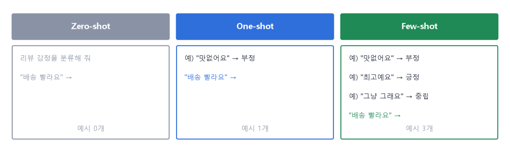
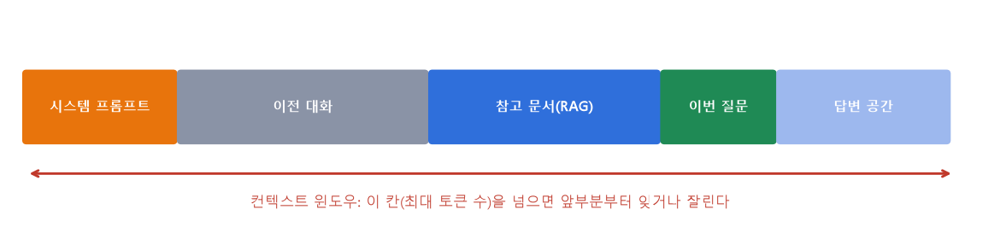
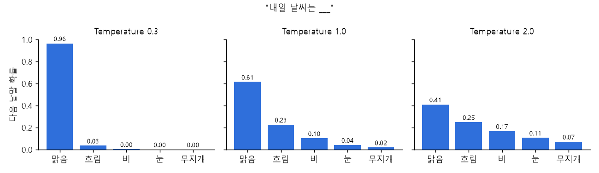
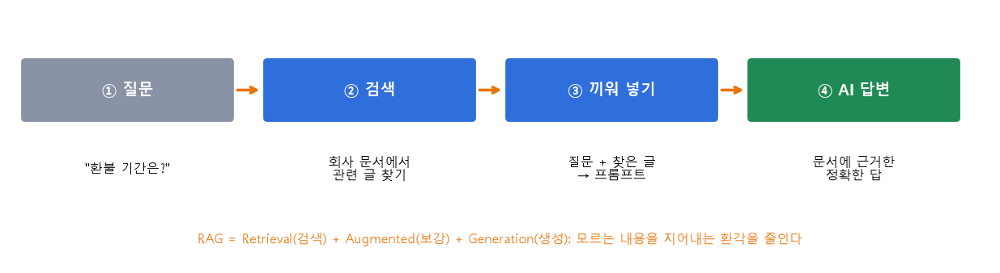

# 12 | 프롬프트 엔지니어링·생성형 AI 용어

@goals
- 프롬프트, 시스템 프롬프트, 사용자 프롬프트의 차이를 안다.
- Zero-shot·One-shot·Few-shot·Chain of Thought 를 상황에 맞게 고른다.
- 토큰·컨텍스트 윈도우·Temperature 가 답변에 주는 영향을 안다.
- Prompt Chaining·RAG 로 긴 문서와 회사 자료를 다루는 방법, 환각(Hallucination)을 줄이는 법을 안다.
@end

## 12.0 | 들어가며: AI 에게 일 잘 시키기

ChatGPT·Claude 같은 **생성형 AI(대형 언어 모델, LLM)** 는 같은 모델이라도 **어떻게 묻느냐**에 따라 답의 품질이 크게 달라져요. 좋은 요청문을 설계하는 기술을 **프롬프트 엔지니어링(Prompt Engineering)** 이라고 해요. 데이터 분석에서도 코드 작성, 결과 해석, 리뷰 분류 등에 AI 를 많이 쓰니 꼭 알아 둘 용어들이에요.

> 💡 프롬프트 예시는 AI 에게 보내는 글이라 실행 결과가 없어요. 직접 AI 에게 붙여 넣어 결과를 비교해 보세요.

## 12.1 | 프롬프트 · Prompt
@term Prompt | AI 모델에게 전달하는 입력 텍스트 (질문, 지시, 맥락, 예시 포함)

AI 에게 보내는 **모든 입력 글**이에요(9장 prompt). 좋은 프롬프트는 보통 네 가지가 들어 있어요.

- **지시**: 무엇을 해 달라는지 ("요약해 줘")
- **맥락**: 배경 정보 ("초등학생에게 설명할 거야")
- **입력 데이터**: 처리할 내용 (리뷰, 표, 코드)
- **출력 형식**: 어떤 모양으로 ("3줄로", "표로", "JSON 으로")

```text
[나쁜 예] 이 데이터 분석해 줘.
[좋은 예] 아래는 쇼핑몰 월별 매출 CSV 야. (입력 데이터)
          마케팅팀 회의에서 쓸 거야. (맥락)
          매출이 가장 많이 오른 달과 이유 후보 3가지를 찾아 줘. (지시)
          결과는 '달 | 증가율 | 이유 후보' 표로 줘. (출력 형식)
```

## 12.2 | 시스템 프롬프트 · System Prompt
@term System Prompt | 대화 전에 AI 의 역할·규칙·출력 형식을 고정하는 최상위 지시문

대화가 시작되기 **전에** 정해 두는 **기본 설정 지시문**이에요. AI 의 역할, 지켜야 할 규칙, 말투, 출력 형식을 정해요. 사용자에게는 보통 보이지 않고, 대화 내내 적용돼요.

```text
[시스템] 너는 데이터 분석 입문자를 돕는 친절한 튜터야.
         - 전문 용어는 꼭 쉬운 말로 풀어 설명해.
         - 코드에는 한국어 주석을 달아.
         - 모르는 것은 모른다고 말해.
```

## 12.3 | 사용자 프롬프트 · User Prompt
@term User Prompt | 사용자가 직접 입력하는 실제 요청 메시지

사용자가 **채팅창에 직접 입력하는** 질문·요청이에요. 시스템 프롬프트가 "무대 설정"이라면 사용자 프롬프트는 "이번 대사"예요.

```text
[사용자] 표준편차가 뭔지 예를 들어 설명해 줘.
```

> 💡 API 로 AI 를 쓸 때는 `system`, `user`, `assistant`(AI 의 답) 역할을 나눠서 메시지를 보내요.

## 12.4 | 제로샷 · Zero-shot
@term Zero-shot | 예시 없이 작업 설명만으로 AI 에게 요청하는 방식

**예시를 하나도 주지 않고** 설명만으로 시키는 방식이에요. 번역·요약처럼 AI 가 이미 잘 아는 간단한 일에 충분해요.



```text
다음 리뷰의 감정을 긍정/부정/중립 중 하나로 답해 줘.
리뷰: "배송이 빨라서 좋았어요"
```

## 12.5 | 원샷 · One-shot
@term One-shot | 예시 1개를 주고 AI 가 패턴을 파악하게 하는 방식

**예시를 딱 하나** 보여 주는 방식이에요. 특히 **출력 형식**(표, JSON 모양)을 맞추고 싶을 때 효과가 좋아요.

```text
리뷰를 아래 형식으로 정리해 줘.
예시) 리뷰: "맛없어요" → {"감정": "부정", "키워드": "맛"}
리뷰: "배송이 빨라서 좋았어요" →
```

## 12.6 | 퓨샷 · Few-shot
@term Few-shot | 예시 2~5개를 주어 정확도와 일관성을 높이는 방식

**예시를 몇 개(보통 3~5개)** 보여 주는 방식이에요. 분류·태깅·감성 분석처럼 **기준을 일관되게** 지켜야 하는 일에 좋아요. 예시는 여러 경우(긍정·부정·중립)를 골고루 넣어요.

```text
리뷰 감정을 분류해 줘.
"맛없어요" → 부정
"최고예요, 또 살게요" → 긍정
"그냥 그래요" → 중립
"배송이 빨라서 좋았어요" →
```

> 💡 5장의 머신러닝은 수천 개 데이터로 **학습**하지만, Few-shot 은 모델을 고치지 않고 **프롬프트 안의 예시만으로** 따라 하게 해요. 이를 **문맥 내 학습(In-context Learning)** 이라고 해요.

## 12.7 | 생각의 사슬 · Chain of Thought
@term Chain of Thought | 단계적으로 생각하라고 지시해 추론 품질을 높이는 기법

"**단계별로 생각해 보자**"처럼 **풀이 과정을 차례로 쓰게** 하는 기법이에요(CoT). 계산, 논리 추론, 의사결정 문제에서 실수가 줄어들어요. 사람도 암산보다 풀이를 쓰면 덜 틀리는 것과 같아요.

```text
가게 방문자 2,000명 중 50명이 샀고, 광고비는 30만 원, 객단가는 2만 원이야.
광고가 이익이었는지 판단해 줘. 전환율 → 매출 → 광고비와 비교 순서로 단계별로 계산해.
```

## 12.8 | 컨텍스트 윈도우 · Context Window
@term Context Window | 모델이 한 번에 처리할 수 있는 최대 토큰 수

AI 가 **한 번에 읽고 기억할 수 있는 글의 양**이에요. **토큰 수**(11장)로 정해져요. 시스템 프롬프트 + 이전 대화 + 넣은 문서 + 질문 + 답변이 모두 이 칸 안에 들어가야 해요. 넘치면 앞부분을 잊거나 잘려요.



> 💡 그래서 아주 긴 문서는 나눠서 처리하거나(Prompt Chaining), 필요한 부분만 찾아서 넣어요(RAG).

## 12.9 | 토큰 수 계산 · Token
@term Token (LLM) | 모델이 처리하는 최소 단위 — 영어 약 4글자, 한글 약 1~2글자가 1토큰

11.3 에서 본 토큰이 생성형 AI 에서는 **요금과 길이의 단위**가 돼요. 대략 **영어 약 4글자 ≒ 1토큰, 한글 약 1~2글자 ≒ 1토큰** 이에요(모델·토크나이저마다 다름). 같은 내용이면 보통 한글이 영어보다 토큰을 더 많이 써요.

```python
# 아주 대략적인 토큰 수 어림 (정확한 값은 각 회사의 토큰 계산 도구로 확인)
def rough_tokens(text):
    ko = sum('가' <= ch <= '힣' for ch in text)        # 한글 글자 수
    other = len(text) - ko
    return round(ko / 1.5 + other / 4)
for t in ["Data analysis is fun.", "데이터 분석은 재미있다."]:
    print(f"{t!r}: 글자 {len(t)}개 → 약 {rough_tokens(t)} 토큰")
```

## 12.10 | 온도 · Temperature
@term Temperature | 응답의 다양성을 조절하는 값 (0 = 결정적·일관, 1 이상 = 창의적·다양)

AI 는 다음 낱말을 **확률**로 골라요. Temperature 는 이 확률을 **얼마나 고르게 펼칠지** 정해요.

- **낮게(0~0.3)**: 가장 확률 높은 낱말만 골라 **늘 비슷한 답** → 분류, 데이터 추출, 코드
- **높게(0.8~1 이상)**: 덜 흔한 낱말도 골라 **다양하고 창의적인 답** → 아이디어, 글쓰기



```python
import numpy as np
words = ["맑음", "흐림", "비", "눈", "무지개"]
scores = np.array([3.0, 2.0, 1.2, 0.3, -0.5])     # 모델이 낸 점수(logit)
for T in [0.3, 1.0, 2.0]:
    p = np.exp(scores / T); p = p / p.sum()       # 온도로 나눈 뒤 소프트맥스 → 확률
    print(f"T={T}:", dict(zip(words, p.round(2).tolist())))
```

## 12.11 | 프롬프트 체이닝 · Prompt Chaining
@term Prompt Chaining | 복잡한 작업을 여러 프롬프트로 나눠 순서대로 실행하는 기법

한 번에 다 시키지 않고 **작은 단계로 쪼개서**, 앞 단계의 결과를 다음 프롬프트에 넣어 **차례로(사슬처럼)** 실행해요. 긴 문서 처리, 보고서 작성처럼 복잡한 일에 좋고, 단계마다 결과를 확인할 수 있어요.

```text
1단계: 고객 리뷰 300개를 읽고 불만 주제를 5개로 묶어 줘.
2단계: (1단계 결과) 주제별로 대표 리뷰 2개와 개수를 표로 정리해 줘.
3단계: (2단계 표) 가장 시급한 주제 1개에 대한 개선안을 3줄로 써 줘.
```

## 12.12 | RAG · 검색 증강 생성
@term RAG | Retrieval-Augmented Generation, 외부 문서를 검색해 프롬프트에 넣어 정확도를 높이는 방식

**R**etrieval(검색) + **A**ugmented(보강) + **G**eneration(생성). AI 가 모르는 내용(회사 규정, 최신 자료)을 묻기 전에 **관련 문서를 먼저 검색해서 프롬프트에 끼워 넣고** 답하게 해요. 근거 문서가 있으니 **지어내는 답(환각)** 이 줄어요.



```python
from sklearn.feature_extraction.text import TfidfVectorizer
from sklearn.metrics.pairwise import cosine_similarity

docs = ["환불은 구매 후 7일 이내에 신청할 수 있습니다.",
        "배송은 결제 후 2~3일 걸립니다.",
        "회원 등급은 구매 금액에 따라 매달 바뀝니다."]
question = "환불 신청 기간이 어떻게 되나요?"
vec = TfidfVectorizer(analyzer="char_wb", ngram_range=(2, 3)).fit(docs + [question])   # 글자 조각 기준 벡터
sims = cosine_similarity(vec.transform([question]), vec.transform(docs))[0]
best = docs[sims.argmax()]                                 # ② 가장 비슷한 문서 검색
print("유사도", sims.round(2))
print(f"③ 프롬프트: 다음 문서만 근거로 답해 줘.\n[문서] {best}\n[질문] {question}")
```

> 💡 실제 RAG 는 11장의 **임베딩**으로 문서를 벡터로 바꿔 **벡터 데이터베이스**에 저장해 두고, 질문과 가장 가까운 문서를 찾아요.

## 12.13 | 환각 · Hallucination
@term Hallucination | AI 가 사실과 다른 내용을 그럴듯하고 자신 있게 만들어 내는 현상

hallucination = **환각, 헛것을 봄.** AI 가 없는 논문·통계·함수 이름을 **진짜처럼 자신 있게** 만들어 내는 현상이에요. AI 는 "사실"이 아니라 "그럴듯한 다음 낱말"을 고르기 때문에 생겨요.

줄이는 방법:

- 근거 자료를 함께 주고(RAG) **"자료에 없으면 모른다고 답해"** 라고 지시하기
- 출처를 함께 달라고 하고 **직접 확인하기**
- 숫자·코드는 **직접 실행·계산해 검증하기**
- Temperature 를 낮추기

!> 분석 보고서에 AI 가 준 숫자나 통계를 넣을 때는 반드시 원본 데이터로 다시 확인하세요.

## 12.14 | 역할 지정 · Role / Persona
@term Role / Persona | AI 에게 전문가 역할을 맡겨 관점과 말투를 일관되게 하는 기법

"너는 10년 차 데이터 분석가야"처럼 **역할(페르소나)** 을 정해 주면, 그 분야의 관점·용어·말투로 일관되게 답해요. 보통 시스템 프롬프트에 넣어요.

```text
너는 통계 교과서를 쓰는 교수야. 고등학생이 이해할 수 있게,
비유 1개와 계산 예시 1개를 넣어 p-value 를 설명해 줘.
```

## 12.15 | 출력 형식 제한 · Format Constraint
@term Format Constraint | 답을 JSON·표 등 정해진 형식으로만 내도록 제한하는 기법

프로그램이 AI 의 답을 받아 자동으로 처리하려면(API 연동) 답의 **모양이 항상 같아야** 해요. "**JSON 으로만 답해**"처럼 형식을 정하고, 받은 뒤에는 11장의 **Pydantic** 같은 도구로 검사해요. 파싱(읽어 들이기) 실패가 줄어요.

```python
import json
# AI 가 이런 형식으로 답하도록 프롬프트에서 요청했다고 하자
ai_answer = '{"감정": "긍정", "점수": 0.92, "키워드": ["배송", "빠름"]}'
data = json.loads(ai_answer)            # 형식이 맞으면 바로 파이썬 딕셔너리로
print(data["감정"], data["점수"], data["키워드"])
```

## 12.16 | 프롬프트 라이브러리 · Prompt Library
@term Prompt Library | 검증된 프롬프트를 목적별로 분류·저장해 두고 팀이 함께 쓰는 자원

잘 동작한 프롬프트를 **목적별로 모아 둔 모음집**이에요. "리뷰 감성 분류용", "SQL 작성용", "주간 보고서 요약용"처럼 정리해 두면 팀원 누구나 같은 품질의 결과를 얻을 수 있어요.

```python
# 아주 간단한 프롬프트 라이브러리: 빈칸({})만 바꿔 다시 쓰기
LIBRARY = {
    "감성분류": "다음 리뷰의 감정을 긍정/부정/중립 중 하나로만 답해 줘.\n리뷰: {review}",
    "용어설명": "'{term}' 을(를) 데이터 분석 초보자에게 비유를 들어 3줄로 설명해 줘.",
}
print(LIBRARY["용어설명"].format(term="표준편차"))
```

## 12.17 | 기법 선택 가이드

상황에 따라 어떤 기법을 쓰면 좋은지 정리했어요.

| 상황 | 추천 기법 | 이유 |
|---|---|---|
| 간단한 번역, 요약 | Zero-shot | 예시 없이도 충분 |
| 특정 형식 출력 (표, JSON) | One-shot + Format | 형식 패턴 학습 |
| 분류, 태깅, 감성 분석 | Few-shot (3~5개) | 패턴 일관성 향상 |
| 복잡한 추론, 수학, 의사결정 | Chain of Thought | 단계적 사고 유도 |
| 긴 문서 처리, 분석 | Prompt Chaining + RAG | 컨텍스트 분산 |
| 전문가 관점 필요 | Role / Persona | 전문성·일관성 확보 |
| API 연동 자동화 | Format Constraint (JSON) | 파싱 안정성 확보 |

@quiz
? 대화 전에 AI 의 역할·규칙·출력 형식을 고정하는 지시문은?
+ System Prompt
- User Prompt
- Token
- Temperature
= 시스템 프롬프트예요. 사용자가 채팅창에 쓰는 것은 User Prompt 예요.
? 예시 3~5개를 주고 패턴을 따라 하게 하는 방식은?
- Zero-shot
- One-shot
+ Few-shot
- RAG
= Few-shot 이에요.
? "단계별로 생각해 보자"라고 풀이 과정을 쓰게 하는 기법은?
- Prompt Library
+ Chain of Thought
- Temperature
- Embedding
= Chain of Thought(생각의 사슬)예요.
? 늘 같은 형식의 일관된 답이 필요할 때 Temperature 는?
+ 낮게 (0 가까이)
- 높게 (1 이상)
- 상관없다
- 음수로
= 낮을수록 결정적이고 일관된 답이 나와요.
? 회사 문서를 검색해 프롬프트에 넣어 답하게 하는 방식은?
- Fine-tuning
+ RAG
- Zero-shot
- Hallucination
= Retrieval-Augmented Generation 이에요.
? AI 가 없는 통계를 사실처럼 자신 있게 만들어 내는 현상은?
- Overfitting
- Context Window
+ Hallucination
- Iteration
= 환각(Hallucination)이에요. 원본으로 꼭 확인하세요.
? 모델이 한 번에 처리할 수 있는 최대 토큰 수는?
+ Context Window
- Batch Size
- Epoch
- Learning Rate
= 컨텍스트 윈도우예요.
@end
